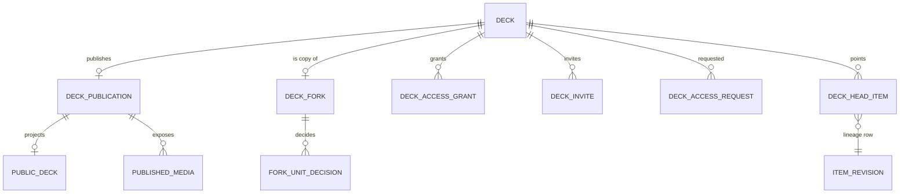

---
artifact:
  id: community-decks-architecture
  type: architecture
  title: "Колоды сообщества: линия ревизий, доступ, копии, обновления, каталог и поиск"
  status: current
  created_at: "2026-10-10"
  updated_at: "2026-10-19"
  owners: ["project-owner"]
  decision_scope: [lineage-storage, deck-access, publication, forks, upstream-updates,
                   media-authorization, catalog-search, ranking-recommendations, public-urls]
  supersedes_clauses:
    - "revision-storage-and-runtime-boundaries.md: 'A future fork … cannot require eager per-item rows' (replaced by §5)"
    - "content-platform-v2.md: visibility PUBLIC/REQUEST_RESTRICTED/PRIVATE (replaced by four levels, §6)"
  evidence:
    - "docs/reviews/community-decks-2026-10/rfc.md (variants, rejected options, owner answers 2026-10-10)"
    - "code and schema of the Learning migrations V49–V71"
---

# Колоды сообщества: архитектура

Архитектура реализована и работает в production. Продуктовое поведение описано в
[контракте](../product/community-decks.md); обоснование и отклонённые варианты — в
[RFC](../reviews/community-decks-2026-10/rfc.md). Статус задач живёт в Issues
[#419](https://github.com/MattoYuzuru/Mnema/issues/419)–[#422](https://github.com/MattoYuzuru/Mnema/issues/422).

Каждый инвариант подтверждается тестом; SQL, планы и тесты — в
[guide Learning](../../backend/services/learning/guide.md), контракты — в
[`contracts/decks`](../../contracts/decks/README.md), [`contracts/community`](../../contracts/community/README.md)
и [`contracts/moderation`](../../contracts/moderation/README.md).

## Состояние реализации

| Часть | Состояние | Миграции |
|---|---|---|
| Согласие и карточки авторов Identity (§11, CD-9) | Реализовано | Identity `V5` |
| Исполнитель задач (§2) | Реализовано (`platform.jobs`) | `V50` |
| Линия: материалы и упражнения (§4, CD-1) | Реализовано | `V51`, `V52` |
| `DeckAccess`, публикация, темы (§6, CD-3, CD-4) | Реализовано | `V53`, `V54` |
| Медиа чужих и гостей (§8, CD-6) | Реализовано | `V55` |
| Приглашения, запросы, гранты (§6) | Реализовано | `V56` |
| Копия O(1) и материализация (§5, CD-2) | Реализовано | `V57` |
| Ссылки и превью без SSR (§9, CD-10) | Реализовано: `/d/{code}`, `/sitemap-decks.xml`; `/u/{username}` — страница приложения без серверного превью | — |
| Жалобы, скрытие, юридическое снятие (§11) | Реализовано; очистка через 3 года не написана ([#409](https://github.com/MattoYuzuru/Mnema/issues/409)) | `V58` |
| Обновления копий (§7, CD-5) | Реализовано; автоприём выключен выключателем `learning.updates.auto.enabled` | `V59`–`V61`, `V63`–`V65` |
| Каталог, поиск, ранг (§10, CD-7, CD-8) | Реализовано, включено в production (`learning.community.catalog.enabled`) | `V66`–`V69` |
| Интересы, события, «Для вас» (§10, CD-8) | Реализовано, включено в production (`learning.community.events.enabled`, `learning.community.for-you.enabled`) | `V70`, `V71` |
| Кабинет: флаги аномалий и «Выбор Мнемы» (§11) | Реализовано | `V68`, `V69` |

В production включены выключатели `public-routes`, публичные медиа, создание копий, жалобы,
каталог, события и «Для вас» ([runtime policy index](../engineering/runtime-policy-index.md));
`COMMUNITY_LAUNCHED` во frontend равен `true`. Автоприём обновлений остаётся выключенным: его
включение — решение владельца.

## 1. Решения

| ID | Решение | Отклонено |
|---|---|---|
| CD-1 | Неизменяемые ревизии материалов, упражнений, целей, привязок, превью и медиа-ссылок принадлежат **линии** (`reuse_scope_id`). Колода хранит только указатели голов и свой журнал изменений. | Копирование строк повтором публикаций (сотни синтетических ревизий). Импорт с сохранением ID (ломает инварианты). Сразу полный copy-on-write (нужен индекс манифеста по ключу; это следующий шаг, §13). |
| CD-2 | Копия создаётся за O(1): колода в линии источника, ревизия на корни опубликованной ревизии, durable pins, `deck_fork`. Указатели голов пишет фоновая задача. | Ленивая материализация: нужен «держатель строк» и двойной путь чтения. |
| CD-3 | Доступ — `DeckAccess`: владелец / грант / публичная / по ссылке. Чужое чтение идёт отдельным read-only путём по опубликованной ревизии. Мутации — только владелец. | Ослабить предикаты владельца в существующих мутациях. |
| CD-4 | Явная публикация `deck_publication.published_revision_id`. Видимость и метаданные лежат в отдельной таблице, потому что `deck_head_guard` блокирует любые колонки `deck`. | Колонки в `deck`; «каждое сохранение публично». |
| CD-5 | Обновление — трёхсторонний план по единицам с frontier-diff страниц. По умолчанию вручную, авто — явная настройка копии и фоновая задача после публикации. | Авто по умолчанию; запись при чтении; рассылка уведомлений копиям. |
| CD-6 | Медиа чужой колоды авторизуются через проекцию `published_media` или головы собственной копии. Не владельцу отдаются только производные варианты. | Сканирование манифеста на запрос; отдача исходников всем. |
| CD-7 | Каталог — проекция `public_deck` над опубликованной ревизией: outbox из публикации, агрегаты считает задача. Поиск — PostgreSQL FTS + `pg_trgm` + синонимы тем. | Внешний движок до порогов §12. Пересчёт агрегатов в транзакции публикации. |
| CD-8 | Ранг пересчитывается раз в час поколениями. Персонализация — интересы по темам, без ML. События лежат в своей схеме с месячными партициями. | Коллаборативная фильтрация и эмбеддинги до порогов. |
| CD-9 | Публичный профиль автора отдаёт Identity только при отдельном согласии (152-ФЗ ст. 10.1). Learning хранит лишь `owner_id`. | Копировать данные Identity в Learning. |
| CD-10 | URL `/d/{code}/{slug}`: случайный код base58, slug вычисляется, 301 на канонический адрес. OG подставляет веб-сервер, без SSR. | `/@author/slug`; Angular SSR сейчас. |

## 2. Компоненты и владение данными

```mermaid
flowchart LR
    Web[Angular] -->|bearer / гость| L[Learning API]
    Web -->|карточки авторов| I[Identity & Account]
    Edge[Caddy/nginx] -->|OG-мета /d/*| L
    L --> Cat[catalog: колоды, материалы, упражнения, чтение по ревизии]
    L --> Lib[library: DeckAccess, гранты, приглашения, публикация, публичное чтение]
    L --> Frk[fork: копия O(1), материализация, автоприём]
    L --> Upd[update: комбинированная публикация, план, применение]
    L --> Mod[moderation: жалобы, скрытие, юридическое снятие]
    L --> Com[community: public_deck, поиск, ранг, интересы, события, полка владельца]
    L --> Med[media: published_media, выдача]
    Jobs[platform.jobs: исполнитель задач] --> Frk
    Jobs --> Upd
    Jobs --> Com
    Cat & Lib & Frk & Upd & Mod & Com & Med --> PG[(PostgreSQL 18)]
    I --> PGI[(app_identity)]
```

- Learning не читает таблицы Identity. Браузер сам берёт карточки авторов у
  Identity: `GET /api/accounts/profiles?ids=…` (до 50 id, только при согласии) и
  `GET /api/accounts/profiles/by-username/{u}`. Так же работает директория
  кабинета.
- Модули `library`, `fork`, `update`, `moderation` и `community` — пакеты в
  `app.mnema.learning`. Своих deployable у них нет.
- Тяжёлая работа выполняется задачами в существующей роли воркера, с отдельными
  очередями и лимитами: копии, применение обновлений, агрегаты, ранг, интересы.
- **Исполнитель задач.** `platform.jobs` даёт lease, retry, progress и per-account
  concurrency; он построен на паттерне `platform/wake` и leases генерации, нового
  фреймворка нет.

## 3. Модель данных (новое и изменённое)



| Таблица | Ключ | Назначение |
|---|---|---|
| `deck_publication` | `deck_id` | `visibility`, `published_revision_id`, `published_at`, `public_code` (unique), `code_rotated_at`, `topic_id`, `content_language`, `target_language`, `level`, `tags`, `release_note`, `requests_enabled`, `row_version` |
| `deck_fork` | `deck_id` | `upstream_deck_id`, `upstream_code`, `base_revision_id`, `forked_at`, `auto_update`, `detached_at`, `materialized_at`, `released_at`, `job_id`; уникальность живой копии `(owner, upstream)` |
| `deck_access_grant` | `(deck_id, grantee_id)` | `role` (`VIEWER`; `EDITOR` в резерве), `granted_by`, `granted_at` |
| `deck_invite` | `invite_id` | `deck_id`, `token_hash` (unique), `max_uses`, `uses`, `expires_at`, `revoked_at`, `code_rotated_at` (поколение ссылки) |
| `deck_access_request` | `(deck_id, requester_id)` | `status`, `created_at`, `decided_at`, `revoked_at` |
| `fork_unit_decision` | `(deck_id, unit_kind, unit_key)` | `reuse_scope_id`, `decision` (`KEEP_MINE` / `DECLINE_NEW` / `KEEP_DELETED` / `PENDING`), `resolved_upstream_revision_id` или `resolved_upstream_absent` (какое состояние автора решено или предложено), `pending_base_revision_id` или `pending_base_absent` (своя база ожидающей единицы), `decided_at`; реализовано в `V61` |
| `published_media` | `(deck_id, asset_id)` | `ref_count` — число медиа-ссылок опубликованных материалов; пишется инкрементально командой публикации, поэтому публикация стоит O(изменений). Только медиа материалов: медиа упражнений публичный просмотр не показывает |
| `topic`, `topic_alias` | `topic_id`; `(alias_norm, topic_id)` | Двухуровневый справочник, синонимы ru/en/исходные |
| `public_deck` | `deck_id` | Проекция каталога (§10), STORED tsvector |
| `deck_engagement` | `(deck_id, account_id, kind)` | `first_at`, `last_at`, `study_days` — источник метрик |
| `deck_rank`, `rank_generation` | `(generation, deck_id)` | Поколения ранга, хранение 24 ч |
| `user_topic_interest` | `(account_id, topic_id)` | `weight`, `updated_at`, ≤20 строк |
| `catalog_event` | `uuidv7` | Месячные партиции, 13 месяцев |
| `deck_exposure_day` | `(deck_id, day, surface)` | `n` |
| `content_complaint` | `complaint_id` | Жалобы и решения; без внешних ключей, чтобы пережить удаление колоды и аккаунта (§11) |
| `content_takedown`, `content_takedown_asset`, `content_takedown_journal` | — | Юридическое снятие ревизий и ассетов, его журнал (§11) |
| `deck_publication_event` | — | Outbox каталога (§10) |
| `learning_job` | — | Очередь исполнителя задач (§2) |

Все новые таблицы — в `app_learning`, кроме согласия на профиль: оно в
`app_identity`.

## 4. Линия: неизменяемые строки (CD-1)

- **Перенос ключей.** `item_revision`, `item_preview`, `content_media_ref`,
  `exercise_revision`, `exercise_content_binding`, `exercise_media_ref`,
  `objective_revision` и идентичности `learning_item`, `exercise_definition`,
  `memory_objective` переходят на ключ `(reuse_scope_id, …)`.
  - `deck_id` и `deck_revision_id` остаются колонками происхождения (origin) без
    FK на колоду читателя.
  - Цепочки ревизий и `sequence` остаются линейными внутри линии. Если правка в
    копии отходит от общей истории, у ревизии есть явный `parent_revision_id`.
    Уникальность по номеру заменяется уникальностью `(reuse_scope_id,
    revision_id)` и проверкой родителя.
- **У колоды остаются:**
  - головы: `deck_head_item`, `deck_head_exercise`, `objective_head`;
  - журналы: `deck_item_change`, `deck_exercise_change`;
  - проекции.

  Головы ссылаются на строки линии. На единицу приходится примерно 0,2–0,25 КБ.
- **Study.** FK Study (`study_candidate`, `study_presentation`, `study_evidence`,
  `study_policy_assignment`) переводятся на строки линии. `deck_id` в них остаётся
  личной колодой ученика. Ключи прогресса не меняются: `(account_id, deck_id,
  objective_id)`.
- **Авторизация** определяется не строкой линии, а только головой колоды или
  опубликованной ревизией, к которой у читателя есть доступ. Голый `revision_id`
  доступа не даёт.
- **Prerequisites:**
  - GC хранилища работает в production
    ([MattoYuzuru/Mnema#417](https://github.com/MattoYuzuru/Mnema/issues/417));
  - прототип «несколько колод в одном scope» проверил GC, пины и уникальности до
    массовой миграции.
- **Миграция.** Пользователей ноль, поэтому миграция идёт в одном окне обслуживания:
  backfill ключей линии из `deck.reuse_scope_id`. Откат — восстановление из
  backup перед миграцией. Двойных записей и адаптеров нет (правило greenfield).
- **Ключи колоды и чтение**
  ([evidence прототипа Share/3](../engineering/evidence/community-decks/epic-1/share-3-lineage-prototype.md)):
  - строки колоды (головы, журналы, черновики, «Эталон», строки Study) несут неизменяемый
    `reuse_scope_id` своей колоды и ссылаются на строки линии через него;
  - чтение «что есть в колоде» начинается с её голов или закреплённых корней манифеста, а не с
    `deck_id` строки линии (это колонка происхождения);
  - генерация кандидатов Study читает закреплённый `exercises_root_id`, а не «ревизию на момент
    `deck_sequence`» автора;
  - медиа-ссылки линии хранят `asset_owner_id`, а ревизия по id видна колоде, только если она
    её голова или есть в её журнале изменений;
  - уникальность номера ревизии на единицу заменена цепочкой родителя с приёмом обновлений (§7).

## 5. Копия (CD-2)

Контракт: [`contracts/decks/forks.json`](../../contracts/decks/forks.json).

1. **`POST /api/decks/forks {commandId, sourceCode}`**: идемпотентно по command id,
   в контексте копирующего. Источник определяется публичным кодом через
   `DeckAccess` (404 как у публичного чтения, 403 `DECK_INVITE_ONLY`, владелец
   источника — 409 `FORK_OWN_DECK`).
   - **Одна живая копия на пару (владелец, источник)**: повторный запрос
     возвращает её (200, `existing=true`); удалённая копия не считается.
     Создания одного аккаунта сериализует advisory lock; лимиты — не больше
     10 неготовых копий на аккаунт (`max-preparing`, 422) и 20 созданий в скользящий час (429).
   - Копия делается из **опубликованной** ревизии источника (публикация
     блокируется `FOR SHARE` на время команды): колода с `reuse_scope_id`
     источника, ревизия 0 с корнями этой ревизии и собственными durable-пинами
     (O(1)), строка `deck_fork` (защита триггером: корни совпадают с
     `base_revision_id`, это опубликованная ревизия источника), задача
     `deck.copy.materialize`.
   - Ответ — id колоды и `preparing=true` (201).
2. **Задача материализации** (`deck.copy.materialize`, по одной на аккаунт) пишет
   головы (`deck_head_item`, `deck_head_exercise` с порядковыми номерами манифеста,
   `objective_head`) **только из манифеста** корней копии, пачками ≤200 записей на
   транзакцию с курсором `{phase, next}`. В последней пачке сверяет числа с
   `member_count`/`exercise_count` и порядковые номера, ставит `materialized_at`.
   Сбой воркера продолжается с курсора; запуск без курсора сначала очищает головы
   копии. Ошибка без надежды — копия остаётся `preparing` с признаком `failed`,
   `POST /api/decks/{id}/fork:retry`.
   - До `materialized_at` любая мутация копии и запуск Study отвечают 409
     `DECK_PREPARING` (перехватчик по шаблону маршрута `/decks/{deckId}/…`,
     проверка в маршрутах с колодой в теле, триггер БД на головах); чтение хаба
     работает, список материалов пуст. Удаление, `fork:retry` и `fork:detach`
     разрешены.
3. Копия копии использует свою опубликованную ревизию, если копия публикуется, или
   недоступна, если копия приватна. Рекурсии нет: корень указывает прямо на
   страницы.
4. **«Отвязать»** (`POST /api/decks/{id}/fork:detach`) ставит `detached_at`.
   Обновления прекращаются, содержимое остаётся.
5. **Чтение.** В JSON колоды владельца есть `fork` (`sourceAvailable` вычисляется
   по сохранённому коду источника; после ротации кода — «недоступен» до
   перепривязки, которую делает повторное «Добавить к себе» по новому коду, §7); в публичной сводке для вошедшего — `myCopy`.
   Выключатель `learning.community.forks.enabled` (по умолчанию выключен)
   отключает только создание.

## 6. Доступ и публикация (CD-3, CD-4)

- **`DeckAccess.resolve(actor | guest, deckId | code)`** возвращает `OWNER`,
  `GRANTEE`, `PUBLIC`, `LINK` или `NONE`.
  - `NONE` для приватной или несуществующей колоды → `NOT_FOUND`, 404.
  - `NONE` для «по приглашению» → `INVITE_ONLY`, 403 без данных колоды; чтение по `id` для не
    владельца работает только для приглашённого на «По приглашению».
  - Колода, скрытая модератором, для всех, кроме владельца, отвечает `NOT_FOUND` на любом уровне (§11).
  - Публичные эндпоинты (гость, `LINK`/`PUBLIC`) — отдельный набор маршрутов без
    JWT, с rate limit по IP/аккаунту.
- **Read-only путь** читает **опубликованную** ревизию. Владелец, читающий свою
  колоду, по-прежнему видит голову. Около 150 предикатов владельца в мутациях не
  ослабляются.
- **Публикация** — команда `POST /decks/{id}/publication`:
  - вход: `expectedHeadRevision`, метаданные, `releaseNote`;
  - CAS по `deck_publication.row_version`, ревизия колоды не создаётся;
  - инкрементально обновляет `published_media`, пишет outbox для `public_deck`;
  - первая публикация происходит при выходе из «Приватной».
- **Смена видимости** не трогает `deck.row_version`, поэтому у открытого редактора
  нет 412. Понижение уровня ротирует `public_code` и навсегда делает прежние пригласительные
  ссылки недействительными (`deck_invite.code_rotated_at` хранит поколение ссылки).
- **Гранты, приглашения, запросы:**
  - приглашение хранится хешем токена и погашается вошедшим пользователем в
    транзакции (`uses < max_uses`, не истекло, не отозвано);
  - запросы ограничены по частоте и шлют агрегированные уведомления
    `DECK_ACCESS_REQUESTED` / `DECK_ACCESS_GRANTED`; о запросе доступа уведомление идёт раз в
    календарные сутки UTC;
  - логин резолвится только для профилей с согласием, ответ одинаков для «нет» и
    «скрыт».

## 7. Обновления (CD-5)

- **Diff.** `frontierDiff(rootA, rootB)` сравнивает множества достижимых id
  страниц двух корней одной линии.
  - Общие поддеревья (path-copy) пропускаются, отличающиеся листья дают
    `(member_key | exercise_key, descriptorA, descriptorB)`.
  - Сдвиг ординалов после вставки на результат не влияет.
  - Цель — O(изменений · log N). Её подтверждает бенчмарк в задаче.
  - `CountedPageDiff` (#440) идёт по уровням сверху вниз и сравнивает id
    страниц: общая страница не читается, а читаются ровно страницы, которых нет в другом дереве. Каждый
    уровень читается одним пакетным запросом (`ImmutableStorage.readMany`, два SQL-запроса). Порядок
    сравнивается по общим ключам и общим страницам, перемещённые ключи определяются как дополнение
    взвешенной наибольшей возрастающей подпоследовательности. Бенчмарк: при одной правке читается
    4, 7 и 8 страниц для 10³, 10⁴ и 10⁵ единиц, при 100 правках — 76, 286 и 501. На PostgreSQL
    при 10⁵ единицах и 100 правках это 57 мс и 14 запросов. Подробности — в
    [guide Learning](../../backend/services/learning/guide.md).
  - Перевыпуск всех страниц («rebuild») для опубликованных линий запрещён: у профилей
    манифестов `members` и `exercises` нет `bulkBuild`, `CountedPages.build` для них
    отказывает, и манифест меняется только path-copy.
- **Единицы:** метаданные колоды, материал, упражнение (включая `enabled`), цель,
  порядок материалов.
- **Классификация** (базы — `deck_fork.base_revision_id` или
  `pending_base_revision_id` единицы):

  | У автора | В копии голова | Класс |
  |---|---|---|
  | изменена | == база | безопасно |
  | изменена | ≠ база, содержимое ≠ (fingerprint) | конфликт |
  | изменена | ≠ база, но содержимое совпадает | безопасно (откат правки) |
  | новая | — | безопасно (если не `DECLINE_NEW`) |
  | удалена | есть | спросить |
  | изменена после `resolved_upstream_revision_id` | — | спросить снова |

- **Зависимости.** Упражнение автора тянет свои материалы и цели. Если у
  ученика своя голова материала, привязка проверяется по node id: узлы есть —
  безопасно, нет — конфликт. Неголовные ревизии из привязок доступны, потому что
  принадлежат линии.
- **План** (`GET /decks/{fork}/update-plan`) закрепляет `forkHead` и
  `upstreamPublished`. Любое расхождение при применении → 409, план строится
  заново.
  - Чтение ничего не пишет. Отпечаток содержимого считается только для пар, где он нужен,
    с общим бюджетом на план; сверх бюджета пара считается конфликтом (осторожный ответ).
  - Изменения автора, которые закрыло юридическое снятие, в план не попадают.
- **Применение** — `POST /decks/{fork}/update-plan:apply` с выбором по единицам.
  - Сервер сам пересчитывает план и строит операции, клиент присылает только выбор по
    единицам. Цель, которую приносит новое упражнение, не отдельная единица, а его часть.
  - Это одна **комбинированная** ревизия копии с материалами, упражнениями, целями,
    метаданными и порядком. Копия «принимает» уже существующие ревизии линии (автора или
    свои прежние), а не пишет новые, поэтому уникальность номера ревизии по колоде-автору
    правки (`(deck_id, member_key, item_sequence)` и аналоги для упражнений и целей)
    отсутствует (`V60`); цепочка родителя и `(reuse_scope_id, revision_id)` остаются. В
    журнале упражнений много единиц на ревизию, повторный приём той же ревизии разрешён
    (возврат единицы). Движок принимает только ревизии, видимые копии или её источнику, и
    только для живой готовой неотвязанной копии.
  - До 100 единиц синхронно (предел команды 10 000), больше — задача
    `deck.combined.publish`; ответ 202, план тогда в состоянии `APPLYING`.
  - Идемпотентно по command id.
  - Применение всегда сдвигает базу копии (`deck_fork.base_revision_id`, только вперёд и не
    дальше опубликованной ревизии источника, `V61`) к опубликованной ревизии плана, а каждая
    показанная, но не решённая единица получает строку `PENDING` со своей старой базой
    (`pending_base_revision_id`). Так принятое безопасное больше не предлагается, а
    ожидающая единица сравнивается со своей базой. Значок «Есть обновление» учитывает и
    такие строки.
- **Авто-режим.** После публикации источника ставится задача-рассылка для копий с
  `auto_update`, созданных или с занятиями за 30 дней: 50 копий в минуту на экземпляр
  через паузу задачи (`Slice.proceedAfter`). Она применяет только безопасное и пишет
  «Что нового». Выключатель `learning.updates.auto.enabled` (по умолчанию выключен)
  останавливает и уже поставленные приёмы. Путь чтения ничего не записывает.
- **Значок «Есть обновление»** вычисляется при чтении: `base_revision_id ≠
  published_revision_id` источника, у которого есть доступ, или у копии есть строки
  `PENDING`; запрос списка остаётся одним на страницу.
- **Перепривязка.** Повторное «Добавить к себе» по новому коду источника меняет сохранённый
  `upstream_code` копии, и только на текущий код источника (`V64`); путь чтения ничего не
  пишет.
- **История.** Журнал применений (50 на копию, `V65`); возврат единицы идёт тем же
  движком и пишет решение, чтобы её не применили снова.
- **Study.** Выдача опирается на актуальные головы, поэтому после применения
  меняются следующие выдачи. Показанная попытка сохраняет снимок.

## 8. Медиа (CD-6)

- **Авторизация ассета для не владельца:**
  - `DeckAccess` к колоде;
  - ассет есть в `published_media` её опубликованной ревизии, **или** зритель —
    владелец копии, и ассет есть в медиа-ссылках голов копии.

  Это O(1) по индексам.
- Медиа-ссылки линии хранят `asset_owner_id`. Запросы, которые джойнят
  `asset.owner_id = ref.owner_id`, переписываются в той же задаче:
  `exercise_media_ready`, `MediaManifestCatalog`, `MediaCatalog`.
- **Тест fail-closed:** отсутствие строк не равно «готово», без `COALESCE(…,
  TRUE)`.
- **Гости и чужие зрители** получают только производные варианты (playback,
  poster, thumbnail) без EXIF, через публичный media-эндпоинт с rate limit.
  Исходник с `attachment` получает только владелец.
- **Офлайн-манифест копии** строится по колоде копии. Холды ассетов автора
  держатся ссылками линии, а GC медиа уже учитывает ссылки контента.
- **Атрибуция** стоковых изображений берётся из provenance. Лицензия NC блокирует
  перевод колоды в «Публичную» с понятной причиной.

## 9. Ссылки, OG, rate limits (CD-10)

- **`public_code`** — 10 символов base58 из CSPRNG, уникальный индекс. При
  коллизии — повтор.
- **Ссылки:** `/d/{code}/{slug}`. Slug — транслит, до 80 символов, вычисляется.
  Неверный slug → 301. Self-canonical.
- **«По ссылке» и «по приглашению»:** без slug, `noindex`, обобщённое OG.
- **OG без SSR.** Веб-сервер для HTML-запросов `/d/*` берёт
  `GET /public/meta/decks/{code}`: короткий кэш, только публичные поля и
  карточка автора с согласием. Он подставляет `title`, `description`, `og:*`,
  `canonical`, `robots` в `index.html`.
  - `GET /api/public/meta/decks/{code}` (JSON) и `…/head` (экранированный
    фрагмент `<head>`), nginx SSI (`include virtual` + `stub`) и `auth_request` для 301; три файла nginx
    (production, автономный образ, локальный стек); без SSR. Сбой вызова отдаёт прежний `index.html`.
    Подробности, порядок установки и отклонённые варианты (njs, `sub_filter`):
    [link previews](../operations/link-previews.md). Страница `/u/:username` есть во frontend, но nginx превью для неё
    не подключает: настоящая карточка требовала бы запроса Learning к Identity по логину на каждый анонимный запрос
    (бюджет 60 за 15 минут на адрес); `GET /api/public/meta/profiles/{username}` отвечает общей карточкой.
- **Sitemap** строится из `public_deck`.
- **Rate limits:**
  - публичное чтение и поиск гостя — по IP;
  - резолв логина и создание запросов — по аккаунту;
  - публичные медиа — по IP и колоде.

## 10. Каталог, поиск, ранг, рекомендации (CD-7, CD-8)

- **`public_deck`** — строка на публичную колоду, только над
  `published_revision_id` (`V67`). Строка есть только у PUBLIC, опубликованных, не скрытых и
  не удалённых колод.
  - Скрытие, понижение уровня и удаление убирают строку **синхронно** в своей транзакции;
    задача `catalog.project` по outbox приводит проекцию к текущему состоянию (а не к
    событию) и пересчитывает агрегаты: состав, медиа-флаги, механики, порог качества.
  - Рядом таблица `catalog_listing`: дата первого входа в каталог (её и показывает «Новое»,
    переключение уровня не поднимает колоду наверх) и результат сканирования механик и
    медиа по ревизии (повторный выход без пересканирования). Механики считаются по
    опубликованному манифесту упражнений срезами, а не инкрементально по журналу: проекция
    самовосстанавливается, стоимость O(упражнений) только при новой ревизии.
  - Поиск:
    - `search_ru` = russian(A название, B описание, C теги);
    - `search_simple` = simple_unaccent(A, B, C);
    - `title_norm`.

    Все три — STORED.
  - На production локаль `en_US.utf8` (libc) строит триграммы кириллицы и CJK; `unaccent`
    установлен суперпользователем, `V66` создаёт конфигурацию `simple_unaccent`. Замеры
    планов и расширений — [evidence](../engineering/evidence/community-decks/epic-3/README.md).
- **Поиск:**
  - `websearch_to_tsquery` по двум векторам;
  - `word_similarity` по `title_norm`;
  - расширение запроса по `topic_alias`;
  - релевантность `0.6·ts_rank_cd(…, 1|32) + 0.2·word_similarity + 0.2·pop_pct`,
    понижение при несовпадении языка;
  - не больше 2000 кандидатов на ветку (`search_ru`, `search_simple`, триграммы `title_norm`)
    и тем по синонимам, 200 лучших по релевантности; без уверенно определённого языка запроса
    понижения нет; курсор `(score, deck_id, generation)`;
  - в транзакции поиска `enable_seqscan=off`: планировщик недооценивал `@@`/`%>`; p95 на
    синтетике не больше ~60 мс при 10⁵ колод (бюджет 200 мс);
  - публичная цепочка маршрутов с необязательным bearer, общий лимитер и bulkhead публичного
    чтения, отдельный семафор поисков (2 на экземпляр);
  - sitemap колод — `/sitemap-decks.xml` (рядом со статическим `sitemap.xml`), кеш до часа.
- **Ранг** (раз в час системной задачей с ключом часа: новое поколение и переключение
  указателя, поколения хранятся 24 часа после завершения) — формула из
  [RFC §11.2](../reviews/community-decks-2026-10/rfc.md#112-базовый-ранг-job-раз-в-час-поколения)
  по `deck_engagement`.
  - Метрики считаются по прямым копиям, без автора. Учитываются `trust_u`, `ln`,
    байесовская активация, свежесть.
  - Против накруток: доля активированных `Q` взвешена доверием, затухание считается отдельно
    для копии и для занятий.
  - Точный score, rank и числа меньше 10 сервер не отдаёт (курсор несёт целый номер места).
  - Ночной запрос аномалий шлёт флаг в кабинет.
- **Метрики.** `deck_engagement` (`V68`) пишется **синхронно** в транзакции копии и
  завершения SCHEDULED-сессии копии (одна проба `deck_fork` по ключу), а не задачей по
  курсору: нет потерь из-за порядка фиксаций. Вес аккаунта берётся из двух служебных
  утверждений Identity в `/userinfo`: `mnema_trusted` (почта подтверждена или есть вход через
  Google, Яндекс, GitHub, и аккаунту не меньше 3 дней) и `mnema_new_account` (моложе 48 часов).
  Learning не читает таблицы Identity.
- **Интересы.** Ночная задача пересчитывает `user_topic_interest` для активных (за 30 дней,
  срезами по аккаунтам):
  - чипы;
  - темы копий;
  - занятия;
  - открытия;
  - цель — после правки политики.

  Инкрементальный upsert при копии. Интересы ограничены 20 темами, весами 8/4/3/1/0,5
  (выбор/копия/занятие/открытие/цель), нормированными на максимум. Цель даёт родителей
  справочника, лист берёт больший вес собственной/родительской темы. Содержимое личных колод
  не читается и никуда не передаётся. Профиль сериализует сброс, выбор, копию и ночной
  пересчёт блокировкой строки аккаунта; у сброса своя граница сигналов (цель и существующие
  копии работают при первом запуске, после сброса — только новые ответы и копии).
  Подтверждения команд интересов хранят только ack, повтор отдаёт актуальный профиль, а не
  историю удалённых интересов. Ночной пересчёт работает при любом из двух выключателей
  «Для вас»/событий; новых утверждений `/userinfo` нет.
- **«Для вас»:**
  - кандидаты: топ-N по трём темам + новые + глобальный топ (около 100);
  - ранжирование: `score × (1 + 0.8·интерес) × (язык ? 1 : 0.3)`; при равном нулевом score
    интерес служит tie-break без изменения формулы;
  - переранжирование: ≤2 одного автора или темы в первых 10, без своих копий; две
    исследовательские позиции доступны в полной полке из 12 (2/12), нехватка разнообразия не
    ослабляет ограничения;
  - собственная версия ранкера `recs-v1`, базовая `catalog-v1`, отдельно от поколения
    популярности; в событии пишется `rank_version`. FORK наследует последнее
    открытие/переход за 30 минут, STUDY_START/DROP — последнюю атрибуцию FORK. STUDY_START
    относится к новым успешным SCHEDULED/PRACTICE (ACTIVE/PREPARING), не к REPLAY/EMPTY;
    глобальная вовлечённость по-прежнему считает завершённые SCHEDULED. Нет подходящего
    события → базовая версия;
  - выдача сохраняет только коды ограниченных кандидатов/выбранных колод и привязки к
    аккаунту, запросу (hash), версии профиля и поколению. В курсоре только случайный handle
    и целое смещение. Курсоры живут до 24 часов, на аккаунт не больше 32 сохранённых
    вопросов; физически истёкшие строки удаляет следующий дневной проход. Вытеснение старого
    вопроса, изменение профиля или истечение поколения дают старому курсору 412.
    Публичность, копии и минимум подходящих кандидатов проверяются повторно при чтении.
    Точные score, веса, ранг и малые аудитории не уходят клиенту или в логи.
- **События.** `catalog_event` (`V70`) партиционирован по времени UTC (месячные партиции),
  `event_id` выдаёт PostgreSQL 18 `uuidv7()`. PK включает время, индекс аккаунт/время служит
  сбросу и пересчёту. Ссылки на источник и ревизию являются историческими идентификаторами
  без FK, чтобы не задерживать GC неизменяемого хранилища. Текста запроса/колоды в таблице
  нет. Current + previous 12 календарных месяцев удерживаются (через 13 месяцев партиция
  удаляется, агрегаты остаются), следующие два создаются заранее. DROP и создание партиций
  ограничены lock/statement timeout; maintenance продолжает работать при выключенной записи.
  - Показы — агрегатом `deck_exposure_day` (день, колода, поверхность, версия ранкера; без
    аккаунта и позиции). Клиент объединяет фактически видимые карточки в команды до 48.
    Подтверждения scope `community.events` живут семь дней и удаляются срезами; прочие
    receipts не меняются.
  - Независимые switches `learning.community.events.enabled` и
    `learning.community.for-you.enabled` по умолчанию `false`; в production включены
    ([runtime policy index](../engineering/runtime-policy-index.md)). Контракт:
    [`contracts/community`](../../contracts/community/README.md); синтетические замеры:
    [evidence](../engineering/evidence/community-decks/epic-4/README.md).
- **Источники.** [PostgreSQL 18 UUID](https://www.postgresql.org/docs/18/functions-uuid.html)
  определил native UUIDv7; [партиции](https://www.postgresql.org/docs/18/ddl-partitioning.html)
  определили календарные границы, PK с временем и bounded DROP; [Angular Signals](https://angular.dev/guide/signals)
  определил состояние UI; [Spring Security JWT](https://docs.spring.io/spring-security/reference/servlet/oauth2/resource-server/jwt.html)
  подтвердил использование существующей приватной bearer-цепочки.

## 11. Безопасность, ПДн, модерация (CD-9)

- **Identity.**
  - Согласие на публичный профиль: по полям, снимаемое, журнал версий текста.
  - `GET /profiles/**` и avatar без согласия ведут себя как для неизвестного
    аккаунта.
  - Логин обязателен, чтобы публиковать.
  - Ни один публичный API не отдаёт `owner_id`.
  - Learning узнаёт о согласии из утверждения `mnema_public_profile` в `/userinfo`; проверка
    повторяется только при выходе колоды наружу, не при безобидной правке. Решение владельца
    2026-10-11: отзыв согласия скрывает автора сразу, а уже публичная колода остаётся
    публичной без подписи.
- **Жалобы.** `content_complaint`:
  - цель — колода или профиль;
  - причина, статус, решение, срок ≤30 дней;
  - журнал снятий.
- **Кабинет владельца:**
  - очередь жалоб;
  - скрытие (`HIDDEN`): флаг `hidden_by_moderation` в `deck_publication`, а не только
    `rank_penalty=0`. Для всех, кроме владельца, `DeckAccess` отвечает `NOT_FOUND` на любом
    уровне (даже вместо 403 для «по приглашению»), поэтому скрытая колода пропадает из
    просмотра, медиа, превью, приглашений, запросов, копирования и жалоб; каталог читает тот
    же флаг; копии не затрагиваются;
  - юридическое снятие;
  - флаги аномалий;
  - «Выбор Мнемы».
- **Юридическое снятие** действует по линии. Единица снятия — ревизия материала или
  упражнения; один предикат `ContentTakedowns` проверяют все читатели (публичные страницы,
  чтения владельца, Study, AI-контекст, подсказки речи, медиа, офлайн-манифест). Один ряд
  блокирует источник и все копии, чья голова совпадает с названной ревизией: стоимость
  O(названных единиц), а не O(копий). Своя правка ученика, которая удалила спорное,
  остаётся доступной. **Медиа снимается по ассету** во всей линии (в том числе у
  загрузившего). Принятый риск ключа по ревизии: тот же текст, заново сохранённый автором,
  становится новой ревизией и не блокируется; средство — `HIDDEN`. Журнала отмены снятия и
  предела жалоб на одну цель нет.
- **Удаление аккаунта автора** должно убирать его публичные колоды из каталога, а копии и
  строки линии, на которые ссылаются копии, оставлять. Purge в Learning не реализован
  ([#409](https://github.com/MattoYuzuru/Mnema/issues/409)): пока колоды остаются в каталоге
  без подписи автора (его карточка Identity — 404). Медиа, ставшее READY после публикации, и
  юридическое снятие отдельной единицы не перепроецируют колоду (видно при следующей
  публикации или перестройке).
- **Ссылки** в публичном контенте получают `rel="ugc nofollow"`. Комментариев и
  сообщений нет.

## 12. Нагрузка: ноль и высокий MAU

Требование владельца: каждое решение должно быть допустимо и при нулевой
нагрузке, и при большом MAU. Сценарий **H** — гипотеза для проверки границ, не
прогноз: 100k MAU, 20k DAU, 5k публичных колод средним размером 300 единиц,
2 копии на MAU (200k копий), одна «вирусная» колода с 20k копий. Размеры строк
взяты по средним локальной БД (±2×).

| Решение | При нуле | При H | Триггер / план |
|---|---|---|---|
| CD-1/2 указатели копий | Пусто, без затрат | 200k × 300 × ~0,23 КБ ≈ **14 ГБ**; вирусная колода 20k × 600 × 0,23 КБ ≈ 2,8 ГБ | Указатели больше ~15% БД или колода больше ~10⁴ копий → полный copy-on-write (разреженные головы + key-addressed манифест). CD-1 — его предпосылка. |
| Задача копий | Простаивает | Пик 2k копий в час × 600 ≈ 330 строк/с — для PG нормально | Очередь с per-account=1 и глобальным лимитом |
| CD-5 авто-обновления | Нет | Публикация вирусной колоды × 20k авто-копий: при троттлинге 50 копий в минуту ≈ 7 ч | Только активные за 30 дней. Ручной экран доступен сразу |
| Чтение каталога и поиска | Пустые состояния, без задач | 20k DAU × 10 запросов ≈ 2,3 rps в среднем, ~25 rps в пике; индексный запрос < 10 мс | Больше ~100k публичных колод или p95 больше 200 мс → BM25 или внешний движок |
| Ранг и метрики | Задача на пустых таблицах, миллисекунды | `deck_engagement` ≈ 300k строк, пересчёт за секунды | Распределённый кэш не нужен |
| Интересы | Пустой срез около 2 мс; при выключенных switches ночной задачи нет | 2M строк ≈238 МБ; 25 профилей ≈246 мс → 100k ≈16,4 мин (экстраполяция) | Инкремент при копии/цели, keyset по 25 активным аккаунтам |
| События | Пустой maintenance около 8 мс | 1M строк замерено: ≈206 Б/строку → 47M ≈9,66 ГБ (экстраполяция); индекс аккаунт/время | Месячные партиции. При давлении на диск — сэмплирование `DETAIL_VIEW` (решение владельца) |
| Медиа публичных колод | Нет | Исходящий трафик Object Storage растёт с гостями | Rate limit гостя, метрика M-07, CDN для производных вариантов — отдельное решение |
| Study (существующее) | — | Замер #460: выдача ≈1,65 КБ со всеми индексами, всего Study ≈2,4 ГБ в день брутто при 600k выдач. После retention (#460, горизонт 7 дней) окно снимков ≈10 ГБ, постоянный слой (попытки, evidence, переходы) ≈0,9 ГБ в день | Retention выдач и генераций сделан (#460). Следующий триггер — постоянный слой: сжатие JSON исходов scheduled-попыток (−0,32 ГБ в день, нужна правка контракта и решение владельца) |
| Identity, карточки авторов | — | ~25 rps батчей по ≤24 id | Кэш браузера; лимит батча 50 |

Замеры Recs/1–3 локально на PostgreSQL 18/Colima: [полные планы и размеры](../engineering/evidence/community-decks/epic-4/scale-local-2026-10-13.txt).
При H (5k публичных, 200k копий, 100k профилей/2M интересов) SQL кандидатов p95 ≈4,05 мс,
переранжирование p95 ≈2,59 мс, constrained 100 кандидатов ≈7,17 мс. Пустой SQL около25 мс
первого вызова, без сканирования пользовательских данных. 200k сохранённых вопросов ≈435 МБ,
140k анонимных дневных строк показов ≈21 МБ; physical cache может удерживаться до следующего
дневного прохода после 24 часов логической годности. Подтверждение телеметрии ≈265 Б со всеми
индексами: семь дней ×120k команд/сутки ≈222 МБ **плюс** команды показов, объём которых зависит
от batch. Например, 320k общих команд/сутки дают примерно593 МБ за семь дней. Эти объёмы
добавляются к raw events. Хранение необработанных событий измерено на1M строк **в одном
месяце**; полные47M/13 месяцев и whole nightly100k не были прогнаны. Нужен production-замер
распределения/IO перед выводом о VPS, без изменения срока или sampling без владельца.

Вывод: всё работает на одном VPS и одном PostgreSQL от нуля до порядка 20–30k MAU.
Ближе к H нужны две вещи из плана: copy-on-write голов и retention Study. Retention
выдач сделан (#460); copy-on-write голов и сжатие постоянного слоя Study записаны
триггерами, а не обещаниями.

## 13. Эволюция

1. **CD-1 → полный copy-on-write** по триггеру §12. Головы копии становятся
   разреженными, нетронутые единицы разрешаются через key-addressed манифест
   базы.
2. **Рекомендации:** co-occurrence «добавившие X добавили Y» (~2–5k активных) →
   эмбеддинги в pgvector (больше 20–50k колод или межъязыковой поиск).
3. **Поиск:** `pg_textsearch` (BM25) → Manticore или Meilisearch по порогам.
4. **Вклад автору (pull request)** и соавторы (`role=EDITOR`). Merge-рёбра
   провенанса добавляются отдельно от основного родителя.

## 14. Наблюдаемость и операции

- **Метрики:**
  - очередь и возраст задач копий, обновлений, агрегатов и ранга;
  - длительность материализации;
  - размер плана;
  - доля конфликтов;
  - 404/403/429 публичных маршрутов;
  - поколение ранга и его возраст;
  - отношение указателей копий к объёму БД (триггер §12).
- **Kill switches:** публичные маршруты, создание копий, авто-обновления,
  «Для вас», публичные медиа.
- **Логи** структурные, без содержимого колод и без токенов приглашений.

## 15. Технические вопросы, закрытые реализацией

- Исполнитель задач: общий `platform.jobs` на паттерне wake и leases (§2).
- Порядок переноса FK Study на строки линии и окно миграции: проверены прототипом
  ([evidence](../engineering/evidence/community-decks/epic-1/share-3-lineage-prototype.md)), выполнены (§4).
- Проверка `show_trgm('Привет')` на production-образе и установка `unaccent`: на production 7 триграмм
  (`en_US.utf8`, libc), `unaccent` установлен, `V66` создаёт `simple_unaccent`;
  [evidence каталога](../engineering/evidence/community-decks/epic-3/README.md).
