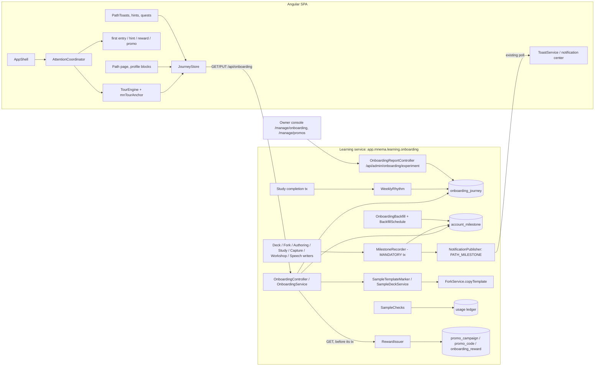

---
artifact:
  id: onboarding-architecture
  type: architecture
  title: "Onboarding architecture: journey state, tour engine, milestones, sample deck, rhythm, reward"
  status: current
  created_at: "2026-10-14"
  updated_at: "2026-10-19"
  owners: ["project-owner"]
---

# Архитектура онбординга

Устройство реализованной системы. Поведение — [proposal](proposal.md); решения и отвергнутые варианты — ADR в [adr/](adr/);
wire-контракт и исполняемые фикстуры — [`contracts/onboarding`](../../../contracts/onboarding/README.md); backend-подробности и тесты —
[guide Learning](../../../backend/services/learning/guide.md) («Onboarding …»). Числа нагрузки в §10 — измерения на Testcontainers
PostgreSQL там, где так сказано, и оценки по модели H из [community architecture §12](../../architecture/community-decks.md) — там, где сказано «оценка».

## 1. Требования

**Функциональные.** Однократное предложение «Начала пути» новому аккаунту; опрос до 4 вопросов; spotlight-тур с ветками, паузой,
продолжением на другом устройстве, завершением, отменой завершения и перепрохождением; учебная колода по запросу; вехи «Пути»,
вычисляемые из реальных действий, включая прошлую историю; тосты вех; недельный ритм; награда за полный «Путь».

**Нефункциональные.** Ни одна часть онбординга не ломает и не замедляет основное действие (создание колоды, занятие, копию):
writers вех — один индексированный upsert в транзакции события, ошибки чтения онбординга деградируют до «тура нет». Команды идемпотентны
по `commandId` и сравниваются по `rowVersion`, как в остальных контрактах. Текстов пользователя в новых таблицах нет. A11y: WCAG 2.2 AA для тура.
Новых зависимостей нет, `@angular/cdk` не добавляется ([ADR-ONB-001](adr/adr-onb-001-tour-engine.md)).

## 2. Компоненты и владение



| Компонент | Владелец | Ответственность |
|---|---|---|
| `onboarding` package (Learning) | Learning | Состояние тура, API, eligibility, вехи, backfill, ритм, учебная колода, награда |
| `MilestoneRecorder` | Learning, вызывается доменными writers | Upsert вехи + уведомление в той же транзакции |
| `WeeklyRhythm` | Learning, вызывается из транзакции завершения занятия | Засчитывает неделю в `onboarding_journey` |
| `RewardIssuer` | Learning, вызывается из `GET /api/onboarding` | Выдаёт персональный код кампании |
| `SampleTemplateMarker`, `SampleDeckService`, `SampleChecks` | Learning | Пометка шаблона, создание копии, бесплатные проверки |
| `TourEngine`, `AttentionCoordinator`, `JourneyStore`, `PathToasts` (frontend, `core/onboarding`) | Frontend | Определения туров, spotlight, пауза, синхронизация; очередь «громких» поверхностей; тосты вех |
| Identity | Identity | Только существующие claims (`mnema_new_account`, `mnema_trusted`); новых данных не хранит |

Почему Learning, а не Identity и не новый сервис: все факты вех, профиль цели, интересы, уведомления, промокоды и A/B уже живут в Learning;
отдельный сервис добавил бы межсервисную консистентность ради нескольких таблиц без отдельной нагрузки.

## 3. Модель данных (Learning, миграции V72–V76)

Миграции аддитивны. Сокращённо:

```sql
-- V72: состояние тура. Нет строки или state=NOT_OFFERED — «не предлагалось».
CREATE TABLE onboarding_journey (
  account_id     uuid PRIMARY KEY,
  tour_version   smallint NOT NULL CHECK (tour_version >= 1),
  state          text NOT NULL CHECK (state IN ('NOT_OFFERED','OFFERED','IN_PROGRESS','PAUSED','SKIPPED','COMPLETED')), -- NOT_OFFERED с V75
  cohort         text NULL CHECK (cohort IN ('TOUR','CONTROL','UNASSIGNED')),   -- holdout, замораживается при создании
  branch         text NULL CHECK (branch IN ('SAMPLE','COMMUNITY','OWN')),
  step_key       text NULL CHECK (char_length(step_key) BETWEEN 1 AND 64),
  experience     text NULL CHECK (experience IN ('NEW','FAMILIAR','CONFIDENT')),
  weekly_target  smallint NULL CHECK (weekly_target BETWEEN 1 AND 7),
  offered_at     timestamptz NULL,            -- NOT NULL до V75; теперь NULL только у NOT_OFFERED
  finished_at    timestamptz NULL,            -- CHECK: задан ровно для SKIPPED/COMPLETED
  replay_count   smallint NOT NULL DEFAULT 0,
  weeks_met      smallint NOT NULL DEFAULT 0, -- ритм, §7
  last_met_week  date NULL,                   -- понедельник последней засчитанной недели; CHECK: isodow = 1, (weeks_met = 0) = (last_met_week IS NULL)
  row_version    bigint NOT NULL DEFAULT 0,
  updated_at     timestamptz NOT NULL
);                                            -- + индекс command_receipt_onboarding_actor

-- V73: назначение колоды. Меняется только USER -> SAMPLE_TEMPLATE (deck_head_guard).
ALTER TABLE deck ADD COLUMN purpose text NOT NULL DEFAULT 'USER' CHECK (purpose IN ('USER','SAMPLE_TEMPLATE','SAMPLE'));
CREATE UNIQUE INDEX deck_one_live_sample ON deck (owner_id) WHERE purpose = 'SAMPLE' AND deleted_at IS NULL;
CREATE INDEX usage_ledger_sample_check ON usage_ledger_entry (owner_id) WHERE operation = 'ONBOARDING_SAMPLE_CHECK';

-- V74: факты вех, версия пройденного backfill, индекс учебных дней, маршрут PATH уведомлений.
CREATE TABLE account_milestone (
  account_id uuid NOT NULL, milestone_key text NOT NULL,   -- CHECK по закрытому реестру версии 1 (13 ключей)
  progress smallint NOT NULL CHECK (progress BETWEEN 1 AND 3),
  achieved_at timestamptz NULL, first_at timestamptz NOT NULL,   -- CHECK: achieved_at >= first_at
  source text NOT NULL CHECK (source IN ('LIVE','BACKFILL')),
  PRIMARY KEY (account_id, milestone_key));
CREATE TABLE onboarding_backfill_run (registry_version smallint PRIMARY KEY, finished_at timestamptz NOT NULL);
CREATE INDEX study_session_study_dates ON study_session (account_id, local_study_date) WHERE status = 'COMPLETE' AND mode IN ('SCHEDULED','PRACTICE');
-- notification_route_check теперь допускает 'PATH'.

-- V75: NOT_OFFERED хранится (CHECK: offered_at IS NULL и cohort IS NULL тогда и только тогда), чтобы цель и недели жили у любого аккаунта.
-- V76: кампании и персональные коды, награда (один раз на аккаунт).
CREATE TABLE promo_campaign (campaign_id uuid PRIMARY KEY, type text CHECK (type IN ('PATH_REWARD')), offer_type text, plan text, days int, percent int,
                             enabled boolean NOT NULL, ...);             -- partial unique (type) WHERE enabled
ALTER TABLE promo_code ADD COLUMN campaign_id uuid REFERENCES promo_campaign, ADD COLUMN recipient_id uuid; -- CHECK: оба NULL или оба заданы
CREATE TABLE onboarding_reward (account_id uuid PRIMARY KEY, campaign_id uuid NOT NULL, promo_code_id uuid NOT NULL UNIQUE,
                                issued_at timestamptz NOT NULL, expires_at timestamptz NOT NULL CHECK (expires_at > issued_at));
-- admin_audit получает действия PROMO_CAMPAIGN_CREATE/ENABLE/DISABLE.
```

- **Состояние на проводе.** Нет строки и строка `NOT_OFFERED` читаются одинаково (`rowVersion "0"`). `eligible` — строка создана по eligibility;
  `autoOffer` — клиент сам открывает «Начало пути» (`OFFERED`, `eligible`, не `CONTROL`). Переходы — таблица `journey.json.transitions`;
  `UNDO_FINISH` возвращает `SKIPPED → OFFERED`, `COMPLETED → PAUSED`; `REPLAY` из `NOT_OFFERED` создаёт строку с версией 1.
- **Строка `NOT_OFFERED`** (без когорты и `offered_at`) создаётся первой выполненной неделей ритма или `PUT /preferences`; первое чтение
  eligible-аккаунта превращает её в `OFFERED` (`INSERT … ON CONFLICT DO UPDATE … WHERE state = 'NOT_OFFERED'`); `REPLAY` идёт обычным обновлением.
  Отдельная таблица ритма отвергнута: два места цели и версии вместо одного.
- **Когорта.** `TOUR`/`CONTROL` по эксперименту `onboarding_v1`; `UNASSIGNED` — эксперимент выключен или нет секрета (тур есть, в отчёт не входит);
  NULL — строка создана перепрохождением (`REPLAY`) вне когорты.
- `weekly_target` и `experience` лежат в journey, а не в `learning_profile`: это настройки онбординга и ритма; перенос в профиль
  потребовал бы правки политики ПДн (как у цели).
- **Квитанции команд.** Каждая команда тура хранит вид (~0,5 КБ) в `command_receipt`: 10–20 КБ на аккаунт, оценка 2–4 ГБ при 200k аккаунтов.
  Retention sweep, как у событий каталога, — отдельная задача.
- Account purge (#409): таблицы `onboarding_journey`, `account_milestone`, `onboarding_reward` удаляются по `account_id` (TODO в репозиториях).
- Ритм по дням не хранится: вычисляется из `study_session` (§7); хранятся только цель и счётчик недель.

## 4. API (Learning, private, RFC 9457, strong ETag)

| Метод | Назначение | Семантика |
|---|---|---|
| `GET /api/onboarding` | Journey + вехи + ритм + награда | Создаёт `OFFERED` строку для eligible аккаунта; ETag — 128 бит SHA-256 канонического JSON вида; 304 по `If-None-Match`; перед своей транзакцией вызывает `RewardIssuer` |
| `PUT /api/onboarding/journey` | Команда тура | `{commandId, rowVersion, action: START\|STEP\|PAUSE\|RESUME\|SKIP\|COMPLETE\|UNDO_FINISH\|REPLAY, branch?, stepKey?}`; 412 `VERSION_CONFLICT`; повтор `commandId` возвращает прежний вид |
| `PUT /api/onboarding/preferences` | Опыт и цель ритма | `{commandId, rowVersion, experience?, weeklyTarget?}`; работает в любом состоянии |
| `POST /api/onboarding/sample-deck` | Учебная колода | `{commandId}` → `201` или `200` существующая живая; `409 SAMPLE_DECK_UNAVAILABLE`, если шаблон не настроен |
| `GET /api/admin/onboarding/experiment` | Отчёт holdout | Только агрегаты: размер групп, активация, возврат; окно 1–90 дней |

Опрос использует существующие `PUT /api/learning-profile` и `PUT /api/community/interests`.

**Eligibility.** Время БД ≥ `learning.onboarding.eligible-from`, Identity помечает аккаунт новым (`mnema_new_account`, младше 48 ч; нет claim —
не новый) и нет живых колод. Отдельной таблицы «первого появления» нет. Иначе `eligible=false`, но вехи и ритм всё равно отдаются.

**Выключатели:** `learning.onboarding.enabled` (выкл.: `journey: null`, команды `409 ONBOARDING_UNAVAILABLE`, БД не читается, вехи продолжают писаться),
`sample-deck.enabled`, `rhythm.enabled`, `backfill.enabled`, `reward.enabled`. Значения в production — [README](README.md#что-включено-в-production).

**Шаги.** Закрытый реестр `stepKey` версии 1 (20 ключей) в контракте; backend и frontend сверяют его тестами; метрика
`mnema_onboarding_journey_total{action,step}` берёт метки только из реестра.

**Эксперимент.** Ключ `onboarding_v1`, `control:15,tour:85`, `client=false`: вариант не уходит в `GET /api/plans`, клиентские события не считаются;
EXPOSURE считает сервер после коммита создания строки. Активация и возврат считаются в отчёте по `study_session`. Кабинет — `/manage/onboarding`,
предупреждение при группе < 100.

Ответ `GET` (сокращённо):

```json
{
  "enabled": true,
  "journey": {"state": "PAUSED", "tourVersion": 1, "branch": "SAMPLE", "stepKey": "sample.exercises",
              "experience": "NEW", "weeklyTarget": 3, "eligible": true, "autoOffer": false, "rowVersion": "7"},
  "milestones": [{"key": "FIRST_DECK", "state": "DONE", "progress": 1, "target": 1, "achievedAt": "…"},
                 {"key": "OWN_EXERCISES", "state": "PARTIAL", "progress": 2, "target": 3}],
  "path": {"done": 4, "total": 13, "hidden": ["COMMUNITY_COPY"]},
  "rhythm": {"weekStart": "2026-10-12", "today": "2026-10-14", "target": 3, "days": ["2026-10-12", "2026-10-14"], "weeksMet": 1},
  "sampleDeck": {"available": true, "deckId": "…", "updateAvailable": false, "freeChecksLeft": 3},
  "reward": null
}
```

## 5. Вехи: запись и backfill ([ADR-ONB-002](adr/adr-onb-002-milestones.md))

**Реестр** — enum `MilestoneKey` + фикстура [`milestones.json`](../../../contracts/onboarding/milestones.json) (key, chapter, target, visibility,
route key, writer, что восстанавливает backfill). Клиент рисует тексты сам по key. Тест классифицирует все изменяющие маршруты (маршрут →
ожидаемые вехи) и падает на неклассифицированном; второй тест сверяет `writer` фикстуры с упоминаниями `MilestoneKey` в коде.

**Запись.** `MilestoneRecorder` (`@Transactional(MANDATORY)`):

- `reach(level)` — стадии и даты (`progress = max`); `increment` — счётчик (`OWN_EXERCISES`); `reachInUserDeck` — условие `purpose='USER'` в том же
  выражении для writer'а, у которого есть только id колоды; `sessionCompleted(mode, localStudyDate)` — вехи занятия.
- Веха с целью 1 — `INSERT … ON CONFLICT DO NOTHING` (без блокировки существующей строки). Стадии (`reach`) и счётчики (`increment`) — upsert,
  `WHERE` которого оставляет в покое достигнутую строку и строку, чей прогресс не растёт:

```sql
INSERT INTO account_milestone AS m (account_id, milestone_key, progress, achieved_at, first_at, source)
SELECT :account, :key, :level, CASE WHEN :level >= :target THEN statement_timestamp() END, statement_timestamp(), 'LIVE'
ON CONFLICT (account_id, milestone_key) DO UPDATE
  SET progress = EXCLUDED.progress,
      achieved_at = CASE WHEN EXCLUDED.progress >= :target THEN GREATEST(statement_timestamp(), m.first_at) END
  WHERE m.achieved_at IS NULL AND m.progress < EXCLUDED.progress
RETURNING (achieved_at IS NOT NULL) AS achieved;
```

  Повтор ничего не пишет; «достигнуто этим выражением» = вернулась строка с `achieved_at`.
- **Уведомление в `beforeCommit`.** Recorder копит достигнутые вехи транзакции и публикует `PATH_MILESTONE` (route `PATH`, params
  `key`, `done`, `total`, dedupe `path:<key>`) одной синхронизацией перед commit — последней записью транзакции, как требует `NotificationPublisher`
  (lock строки курсора). Только при `learning.onboarding.enabled`; вехи, скрытые конфигурацией, записываются, но не объявляются.
- Фиксация в транзакции доменного действия — тот же idiom, что `DeckEngagement` и уведомления: нет outbox-лага и второй очереди. Цена — один
  PK-upsert на событие; при сбое откатывается и действие, поэтому выражение не имеет внешних зависимостей и не трогает чужие строки.

| Веха | Точка вызова |
|---|---|
| FIRST_DECK | `DeckService.create`, `ForkService.copy`, `SampleDeckService` |
| FIRST_SESSION, TWO_DAYS, RHYTHM_WEEK | завершение занятия: `StudySessionRepository.complete`, `AttemptRepository.completeSessionIfTerminal` (SCHEDULED или PRACTICE, не REPLAY, только изменившаяся строка) |
| OWN_MATERIAL, MEDIA_IN_MATERIAL | публикация ревизии материала в колоде `purpose=USER` |
| CAPTURE_NOTE (цель 2) | заметка «На потом» сохранена (1), разобрана — превращена в материал или в архиве (2) |
| OWN_EXERCISES (цель 3) | публикация нового упражнения в колоде `purpose=USER` |
| AI_EXPLANATION | терминальная попытка с effective evaluator `ai-semantic` |
| VOICE_ANSWER | успешная транскрипция |
| WORKSHOP_APPROVED | approve артефакта Мастерской |
| COMMUNITY_COPY | `ForkService.copy` из не-шаблона |
| GOAL_TOLD | `PUT /api/learning-profile` (ответ или пропуск) |

`TWO_DAYS` — цель 2: число разных `local_study_date`; второй день — min/max дат по `study_session_study_dates`, только пока веха не достигнута.

**Видимость.** Операторские флаги (`learning.features.ai-assessment|speech-to-text|ai-generation.enabled`), не circuit breaker и не бюджет;
`COMMUNITY_COPY` — копия из каталога возможна (`catalog`, `public-routes`, `forks` включены и в каталоге хотя бы одна колода — кешированный счётчик);
`RHYTHM_WEEK` — пока включён ритм.

**Backfill** (`OnboardingBackfill`, `BackfillRepository`, `BackfillSchedule`; задача `onboarding.backfill`, `learning.onboarding.backfill.enabled`):
ставится раз на версию реестра (`onboarding.backfill:v1`); пройденная версия записывается в `onboarding_backfill_run`, поэтому после очистки
строки задачи она не запускается снова. Курсор `{key, after}` по вехам и владельцам; граница пачки — loose index scan по индексу владельцев источника;
слияние — одно `INSERT … SELECT … ON CONFLICT DO UPDATE` с `GREATEST(progress)`, `LEAST(first_at)`, сохранением `achieved_at` и `source` строки
(иначе LIVE-строка с меньшим прогрессом не догнала бы историю); строки, которых история не меняет, во вставку не попадают (иначе `DO UPDATE` держал
бы их блокировки); одна пачка — одна транзакция slice. Advisory try-lock, метрики `mnema_onboarding_backfill_seconds`, `…_rows_total{key}`,
`mnema_path_milestone_total{source="BACKFILL"}`; уведомлений нет. Вехи без восстановимой истории (голос, `ai-semantic` после retention,
удалённые заметки, `RHYTHM_WEEK`) остаются невыполненными.

## 6. Учебная колода ([ADR-ONB-003](adr/adr-onb-003-sample-deck.md))

- **Шаблон:** колода аккаунта редакции, id — в `learning.onboarding.sample-deck.template-id`. Команды «сделать шаблоном» нет: Learning при старте
  (каждая роль, идемпотентно) ставит этой колоде `purpose=SAMPLE_TEMPLATE`; колода, созданная после старта, помечается при следующем перезапуске.
  Шаблон публикуется на `LINK` (не в каталоге и поиске): чтение источника копии (`ForkReadModel`) идёт по коду публикации, поэтому только
  опубликованный по ссылке шаблон доставляет копиям «Есть обновление» (CD-5). После пометки владелец шаблона может публиковать новые ревизии только на `LINK`.
- **Создание:** `ForkService.copyTemplate` — та же запись, что у обычной копии, с лимитами аккаунта, без проверки доступа гостя и без
  `FORK_OWN_DECK`; под advisory-lock аккаунта, частичный unique index — страховка; `purpose='SAMPLE'`, `MilestoneRecorder(FIRST_DECK)`.
  Материализация голов — существующая задача `deck.copy.materialize`; тур ждёт статуса `ready` хаба. Повтор `commandId` возвращает тот же код
  (201/200) с `Idempotency-Replayed`.
- **Запреты** — `DeckPurposeGuard` после проверки владения (чужой по-прежнему получает непрозрачный 404): публикация и уровень доступа, выдача доступа,
  приглашения, одобрение запросов, копия по коду → `409 SAMPLE_DECK_NOT_SHAREABLE`. Инвентарный тест перечисляет все изменяющие маршруты
  `library`/`fork` и падает на неклассифицированном.
- **Исключения** — одно условие `deck.purpose = 'USER'` на исходной колоде в `DeckEngagement`, `CatalogOutbox`, `CatalogEvents`,
  `InterestRepository.copyTopics`. Учебная колода не лишает аккаунт права на тур (`hasLiveDeck`).
- **Бесплатные проверки** (`SampleChecks`) — 0-кредитный `DEBIT` с операцией `ONBOARDING_SAMPLE_CHECK` (без бакетов) в той же транзакции, что и платный
  учёт; голосовой ответ с ИИ-оценкой расходует две бесплатные. `GET /api/usage` не меняется: клиент читает `sampleDeck.freeChecksLeft`; кабинет показывает операцию в отчёте.
- **Обновления шаблона:** редакция публикует новую ревизию — копии получают «Есть обновление» стандартным CD-5, автопринятий нет.
- **Стоимость:** O(1) на создание + материализация указателей (оценка ≈ 3 КБ на аккаунт для 12 единиц; для 200k аккаунтов ≈ 0,6 ГБ при 100 % выборе — верхняя оценка).
- Установка шаблона на local stack — [selfhost-local](../../deploy/selfhost-local.md#sample-deck-моя-первая-колода). В production шаблон
  устанавливает владелец; без него `sample-deck.enabled` остаётся выключенным.

## 7. Ритм и награда

### Ритм ([ADR-ONB-004](adr/adr-onb-004-rhythm.md))

Дни вычисляются на чтении по `study_session_study_dates` (V74), без новой таблицы по дням:

```sql
SELECT DISTINCT local_study_date FROM study_session
WHERE account_id = :a AND mode IN ('SCHEDULED','PRACTICE') AND status = 'COMPLETE'
  AND local_study_date >= :weekStart AND local_study_date < :weekStart + 7;
```

Неделя — ISO с понедельника, по `local_study_date`, которую Study уже пишет. `WeeklyRhythm.sessionCompleted` вызывается в транзакции завершения занятия
(рядом с `MilestoneRecorder.sessionCompleted`); при выключенном ритме и для REPLAY — 0 выражений, после засчитанной недели — 1 PK-чтение, до — 4–6.
Пока неделя не засчитана, подсчёт идёт под advisory-lock аккаунта: два одновременных завершения, вместе выполняющие цель, засчитывают её ровно один раз.
`last_met_week` — ключ идемпотентности; `row_version` ритм не трогает (иначе следующая команда тура получила бы 412). Порядок блокировок: advisory-lock
до записи строки и до первой публикации уведомления в транзакции (курсор); `PUT /preferences` берёт тот же lock; проверка ответа ИИ идёт до оплаты
(учёт может опубликовать `USAGE_*` посреди транзакции). `today` — часы БД в поясе `zoneinfo` токена (UTC, как Study).

### Награда ([ADR-ONB-005](adr/adr-onb-005-path-reward.md))

- **Выдача — в `GET /api/onboarding` (`RewardIssuer`), до транзакции чтения и в собственной транзакции**, а не в транзакции последней вехи:
  `mnema_trusted` известен только в запросе, а последняя веха часто приходит из фонового worker (проверка ИИ, распознавание); новый аккаунт
  обычно проходит «Путь» раньше, чем ему исполнится 3 дня. Клиент перечитывает вид после каждого `PATH_MILESTONE`. Вложенная транзакция держала бы два
  соединения на чтение; ошибка выдачи не ломает чтение; без кампании или при лимите — только чтения без блокировок.
- Внутри: advisory-lock аккаунта, повторное чтение кампании `FOR SHARE` (отключение «в полёте» останавливает выдачу), пересчёт вех в этой транзакции,
  дневной лимит кампании (`daily-limit`, под lock кампании), код, `onboarding_reward` (PK `account_id`: один раз на аккаунт).
- **Код** — обычный `promo_code` с `campaign_id` и `recipient_id`: погасить может только получатель (`PROMO_INVALID` для остальных, без оракула).
  Открытый код не хранится — выводится из id кода HMAC-SHA256 под секретом промокодов (≈ 59 бит, rejection sampling); действует с минуты до выдачи
  (расхождение часов БД и приложения) до `issued_at + 7 дней`. Смена секрета промокодов скрывает активный подарок навсегда. Коды кампаний не попадают в общий список промокодов.
- **Кампании** — `promo_campaign` с кабинетом `/manage/promos` и журналом `PROMO_CAMPAIGN_*`; выключатели: `learning.onboarding.reward.enabled` и
  `enabled` кампании; выданные коды не отзываются. Метрика `mnema_path_reward_total{outcome}`. Нюанс: истечение по часам БД (вид) и JVM (погашение) может
  расходиться на секунды у самого конца срока.

## 8. Frontend

- `core/onboarding/`: `JourneyStore` (signals, один GET на вход, ETag, обновление после уведомления `PATH_MILESTONE` и после команд; `load({refresh})`
  во время идущего запроса перечитывает после него, чтобы итоги занятия не получили вид, начатый до завершения), `TourEngine`, `tour-definition.ts`
  (версия, ветки, шаги: `{key, route?, anchor, title, body[], gate: 'next'|'action:<event>', placement}`), директива `mnTourAnchor` с ключами из
  `tour-anchor-keys.ts` — элементы регистрируются по стабильным ключам, а не CSS-селекторам. Компоненты экранов — `features/onboarding/`.
- **Spotlight** ([ADR-ONB-001](adr/adr-onb-001-tour-engine.md)): без новых зависимостей — карточка на `<dialog>`, вуаль — SVG-путь с even-odd вырезом
  во весь viewport (не `<mask>`: вырез не перехватывает нажатия, цель кликабельна без подъёма z-index; forced-colors fallback — рамка `Highlight`);
  позиция цели — `ResizeObserver` + scroll в `requestAnimationFrame`; карточка позиционируется в JS с fallback-сторонами, на узком экране — нижний лист.
- **Фокус и ARIA:** карточка — `role="dialog"` (немодальный для шагов с действием, `showModal()` для информационных), `aria-labelledby` заголовок шага,
  фокус на заголовок при смене шага; цель остаётся в tab-порядке; при action-gated шаге остальная страница `inert`, кроме цели и карточки; Escape → PAUSE
  с возвратом фокуса; live-region (`aria-live=polite`) объявляет «Шаг 2 из 4»; переход по маршруту — фокус на карточку после появления anchor (timeout 4 с →
  текстовый fallback шага).
- **AttentionCoordinator:** одна «громкая» поверхность за раз. Приоритет (`SURFACES`): `system-error` > `study` (QuietZone) > `tour` > `first-entry` >
  `hint` > `reward` > `promo` > `milestone`. Подсказка ждёт занятие, тур и «Начало пути»; промо и тосты вех ждут подсказку. Промо-окно не показывается,
  пока «Начало пути» ждёт, пока тур `IN_PROGRESS`/`PAUSED` и в локальный день завершения тура. Существующий `GoalOnboardingComponent` не показывается
  новым eligible аккаунтам (вопрос живёт в «Начале пути»), остаётся для группы сравнения и старых аккаунтов без ответа.
- **«Путь»:** страница `/profile/path` и блоки профиля (цель, ритм); видны, пока `enabled`. Скрытие «Пути» и заметка «Новое» — настройки клиента
  (localStorage), не сервера. Тосты вех — сервис `PathToasts`: держит тост, пока активна QuietZone (независимо от настройки «Во время занятия»,
  `BADGE_ONLY` не показывает), не чаще одного за 30 с, сводный для нескольких; тихий тост цели недели — по той же политике. Неизвестный клиенту
  `route` уведомления читается как `NONE`.
- **Побочные задания (quests)** — определения того же движка с `quest: true`: шаги `quest.*` вне серверного реестра, `PUT /api/onboarding/journey` не
  отправляется; шаг-экран без якоря и событие завершения `completes`. Бюджет перед стартом клиент считает по `GET /api/usage`.
- **Визуал:** токены `--mn-night`, `--mn-star-lavender`, `--mn-star-paper`, `--mn-scrim` и компоненты `app-tour-card`, `app-night-sky`, `app-path-milestone`
  живут в `/styleguide` (правило «новый элемент — сначала в стайлгайд»); контраст проверяет `color-contrast.spec`.
- **Завершение удержанием (Q03):** параметры общего `app-hold-to-delete-button` (`holdMs`, `armedGlyph`, `armedName`, `tone`, `steppedFill`), без копии компонента;
  поведение клавиатуры и pointer — как у удаления.
- **Деградация:** ошибка `GET /api/onboarding` → тура нет, «Путь» показывает «Не удалось загрузить» с повтором; ни одна страница не ждёт онбординг для своей отрисовки.

## 9. Отказы, согласованность, безопасность

| Ситуация | Поведение |
|---|---|
| Две вкладки двигают тур | `rowVersion` → 412 у второй; вкладка перечитывает и продолжает с серверного шага |
| Потеря ответа на `PUT` | Повтор с тем же `commandId` |
| Колода тура удалена / функция выключена | Шаг пропускается с текстом; тур не падает |
| Материализация учебной колоды долго | Карточка «Готовим колоду…», повтор существующим UI копии; тур ждёт |
| Шаблон не настроен | Вариант «На примере» скрыт (`sampleDeck.available=false`) |
| Уведомление вехи потеряно | Не потеряно: та же транзакция; клиент всё равно видит веху при следующем GET |
| Злоупотребление наградой | Только `mnema_trusted`, одна на аккаунт (`onboarding_reward.account_id` PK), код погашает только получатель, kill switch, аудит выдачи |
| Параллельный backfill и живое событие | Исправляется следующим событием; слияние не понижает прогресс |

Новые данные: состояние тура, опыт, цель ритма, факты вех, награда — персональные данные, связанные с аккаунтом (ответы опроса тем более). Они описаны
в разделе 16 политики ПДн 1.8; срок хранения = жизнь аккаунта, удаление с аккаунтом. Тексты пользователя, названия колод и поисковые запросы в новые
таблицы не пишутся. Логи — только `accountId` хешем по существующим правилам, без params.

## 10. Нагрузка

Измерения на Testcontainers PostgreSQL (JDK 25, Colima), таблица `study_session` в 100k строк, 300 итераций после 100 прогревочных, аккаунт с 2000
завершёнными занятиями; машина была нагружена другими проверками — времена дают порядок величины.

**Горячий путь занятия** (`MilestoneHotPathIntegrationTest` проверяет число выражений в gate, времена снимает opt-in `MilestoneHotPathEvidenceTest`,
`MNEMA_PATH_EVIDENCE=1`):

| Случай | Выражений | Медиана / p95 |
|---|---|---|
| REPLAY | 0 | ≈ 0 |
| Обе вехи занятия уже достигнуты (установившийся режим) | 1 (чтение по PK) | 0,31 / 0,58 мс |
| Второго дня ещё нет, все 2000 занятий сегодня | 2 | 0,86 / 1,37 мс |
| Первое завершение, 400 учебных дней | 4 | 1,28 / 2,17 мс |
| Для масштаба: `DeckEngagement.studied` | 1 | 0,46 / 0,96 мс |

Первая транзакция аккаунта с двумя уведомлениями `PATH_MILESTONE` — ≈ 3,3 мс (p95 4,1 мс), 14 выражений: разовая цена. Ответы (попытки) не платят
ничего, кроме `AI_EXPLANATION` для оценки `ai-semantic` (один upsert). Планы выражений индексные: проверка достигнутых — Index Scan по PK (0,02 мс), веха с
целью 1 уже есть — без записи и блокировки (0,03 мс), проба второго дня — Index Only Scan + Index Only Scan Backward (0,015–0,02 мс), чтение «Пути» для
`GET /api/onboarding` — Index Scan по PK (0,01 мс). Первая версия пробы `EXISTS … local_study_date <> :date` планировалась seq scan (≈ 6 мс) — отсюда индекс V74
и форма min/max.

**Backfill** (`OnboardingBackfillJobIntegrationTest`, 3000 синтетических аккаунтов): повторный запуск не меняет таблицу; прерванный продолжает с места
и приходит к той же таблице; при `enable_seqscan=off` ни одного `Seq Scan` в границе батча и слиянии; работа батча зависит от числа владельцев,
а не от размера источника. Слияние батча из 1000 аккаунтов — 1,1–3,8 мс на веху (наибольшие: `OWN_EXERCISES` 3,8, `TWO_DAYS` 3,4, `OWN_MATERIAL` 3,0).
Оценка для 200k аккаунтов: 200 батчей × 12 вех ≈ 2400 выражений по 1–4 мс плюс пауза (1 с) между slice по 3 с — порядка десятков минут фоновой работы без длинных
блокировок (экстраполяция, не измерение на объёме H).

**Оценка для 200k аккаунтов (модель H):** `account_milestone` ≤ 13 строк × 200k = 2,6 млн строк ≈ 0,25 ГБ с индексом; `onboarding_journey` 200k узких
строк ≈ 30 МБ; ритм — индексный диапазон ≤ 7 дней; нулевые пользователи — таблицы пусты, writers — один PK-upsert без конфликтов.

## 11. Наблюдаемость и эксперимент

Метрики: `mnema_onboarding_journey_total{action,step}`, `mnema_path_milestone_total{key,source}`, `mnema_onboarding_backfill_seconds`,
`mnema_onboarding_backfill_rows_total{key}`, `mnema_onboarding_sample_deck_total{outcome}`, `mnema_path_reward_total{outcome}`; логи без персональных данных.
Holdout: эксперимент `onboarding_v1` (control = без автопредложения тура, «Путь» доступен всем) через существующий `ExperimentAssignments`;
EXPOSURE — при создании строки; активация (первое SCHEDULED-занятие за 7 дней) и возврат (SCHEDULED или PRACTICE в двух разных локальных днях за 14 дней)
считаются в отчёте `GET /api/admin/onboarding/experiment` по `study_session`. Отчёт — агрегаты в кабинете владельца; ни один account id не покидает сервер.
