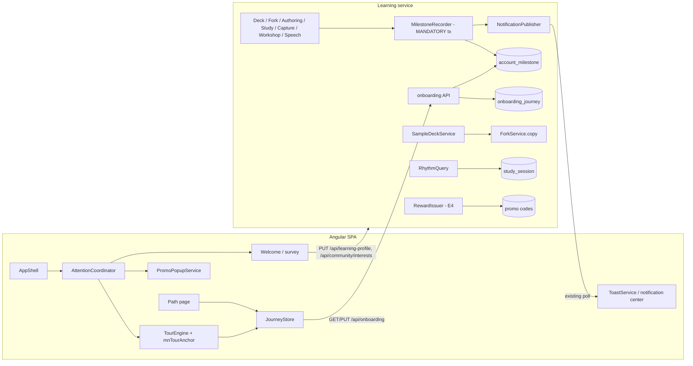

---
artifact:
  id: onboarding-architecture
  type: architecture
  title: "Onboarding architecture: journey state, tour engine, milestones, sample deck, rhythm"
  status: accepted
  created_at: "2026-10-14"
  owners: ["project-owner"]
  base_revision: "f4f5e636 (community epics 3–4, now in main)"
---

# Архитектура онбординга

Поведение — [proposal](proposal.md); выбор и отвергнутые варианты — [RFC](rfc.md) и ADR в
[adr/](adr/). Статус: accepted (решения владельца 2026-10-14); OB-E1 и OB-E2 реализованы и влиты за выключенными флагами (§12–13), OB-E3 — §14. Числа нагрузки ниже — оценки по модели
H из [community architecture §12](../../architecture/community-decks.md), не измерения.

## 1. Требования

**Функциональные.** Однократное предложение «Начала пути» новому аккаунту; опрос до 4 вопросов;
spotlight-тур с ветками, паузой, продолжением на другом устройстве, завершением, отменой
завершения и перепрохождением; учебная колода по запросу; вехи «Пути», вычисляемые из реальных
действий, включая прошлую историю; тосты вех; недельный ритм; опциональная награда.

**Нефункциональные.** Ни одна часть онбординга не может сломать или замедлить основное действие
(создание колоды, занятие, копию): writers вех — один индексированный upsert в транзакции события,
ошибки чтения онбординга деградируют до «тура нет». Идемпотентные команды с `commandId` и
`rowVersion` как в остальных контрактах. Никаких текстов пользователя в новых таблицах.
A11y: WCAG 2.2 AA для тура. Без новых зависимостей, `@angular/cdk` не добавляется ([ADR-ONB-001](adr/adr-onb-001-tour-engine.md)).

## 2. Компоненты и владение



| Компонент | Владелец | Ответственность |
|---|---|---|
| `onboarding` package (Learning) | Learning | Journey state, API, eligibility, вехи, ритм, учебная колода, награда |
| `MilestoneRecorder` | Learning, вызывается доменными writers | Upsert вехи + уведомление в той же транзакции |
| `TourEngine` (frontend, `core/onboarding`) | Frontend | Определения туров, шаги, spotlight, пауза, синхронизация с сервером |
| `AttentionCoordinator` (frontend) | Frontend | Одна «громкая» поверхность за раз: тур, промо-окно, опрос, модальные окна, QuietZone |
| Identity | Identity | Только существующие claims (`mnema_new_account`, `mnema_trusted`); новых данных не хранит |

Почему Learning, а не Identity и не новый сервис: все факты вех, профиль цели, интересы,
уведомления, промокоды и A/B уже живут в Learning; отдельный сервис добавил бы межсервисную
консистентность ради нескольких таблиц без отдельной нагрузки.

## 3. Модель данных (Learning, additive)

```sql
-- Номер миграции — по inventory свежего main (после эпиков 3–4 последняя V71).
CREATE TABLE onboarding_journey (
  account_id      uuid PRIMARY KEY,
  tour_version    smallint    NOT NULL,
  state           text        NOT NULL CHECK (state IN ('OFFERED','IN_PROGRESS','PAUSED','SKIPPED','COMPLETED')),
  branch          text        NULL     CHECK (branch IN ('SAMPLE','COMMUNITY','OWN')),
  step_key        text        NULL     CHECK (length(step_key) <= 64),
  experience      text        NULL     CHECK (experience IN ('NEW','FAMILIAR','CONFIDENT')),
  weekly_target   smallint    NULL     CHECK (weekly_target BETWEEN 1 AND 7),
  offered_at      timestamptz NOT NULL,
  finished_at     timestamptz NULL,
  replay_count    smallint    NOT NULL DEFAULT 0,
  weeks_met       smallint    NOT NULL DEFAULT 0,  -- §7, OB-401
  last_met_week   date        NULL,                -- понедельник последней засчитанной недели
  row_version     bigint      NOT NULL DEFAULT 0,
  updated_at      timestamptz NOT NULL
);

CREATE TABLE account_milestone (
  account_id    uuid        NOT NULL,
  milestone_key text        NOT NULL,            -- из закрытого реестра, CHECK по списку версии
  progress      smallint    NOT NULL DEFAULT 1,   -- для счётных вех, насыщается на target
  achieved_at   timestamptz NULL,                 -- NULL пока progress < target
  first_at      timestamptz NOT NULL,
  source        text        NOT NULL CHECK (source IN ('LIVE','BACKFILL')),
  PRIMARY KEY (account_id, milestone_key)
);

ALTER TABLE deck ADD COLUMN purpose text NOT NULL DEFAULT 'USER'
  CHECK (purpose IN ('USER','SAMPLE_TEMPLATE','SAMPLE'));
CREATE UNIQUE INDEX deck_one_live_sample ON deck (owner_id) WHERE purpose = 'SAMPLE' AND deleted_at IS NULL;
```

- Отсутствие строки `onboarding_journey` = «не предлагалось». Строка создаётся при первом
  `GET /api/onboarding`, если аккаунт eligible.
- `weekly_target` и `experience` лежат в journey, а не в `learning_profile`, потому что это настройки
  онбординга/ритма; если владелец захочет использовать опыт в рекомендациях — перенос в профиль
  требует правки политики ПДн (как цель).
- Имя колонок `deck.owner_id`/`deleted_at` сверить с актуальной схемой; инвариант «одна живая
  учебная колода на аккаунт» обязателен в любой форме.
- Account purge (#409): обе новые таблицы удаляются по `account_id`; TODO в стиле существующих
  `deck_engagement_account`.
- Ритм не хранится: вычисляется из `study_session` (§7).

## 4. API (Learning, private, RFC 9457, strong ETag)

| Метод | Назначение | Семантика |
|---|---|---|
| `GET /api/onboarding` | Journey + вехи + ритм | Создаёт `OFFERED` строку для eligible аккаунта (`INSERT … ON CONFLICT DO NOTHING`); ETag по `row_version` + max(milestone first_at/achieved_at); 304 |
| `PUT /api/onboarding/journey` | Команда тура | `{commandId, rowVersion, action: START|STEP|PAUSE|RESUME|SKIP|COMPLETE|UNDO_FINISH|REPLAY, branch?, stepKey?}`; 412 `VERSION_CONFLICT`; повтор `commandId` возвращает прежний ответ |
| `PUT /api/onboarding/preferences` | Опыт и цель ритма | `{commandId, rowVersion, experience?, weeklyTarget?}` |
| `POST /api/onboarding/sample-deck` | Учебная колода | `{commandId}` → `201 {deckId}` или `200` существующая живая; 409 если шаблон не настроен |

Опрос использует существующие `PUT /api/learning-profile` и `PUT /api/community/interests`.
Eligibility: аккаунт впервые увиден Learning после `learning.onboarding.eligible-from` (конфиг даты
релиза) **и** нет своих колод; иначе `eligible=false`, но вехи и ритм всё равно отдаются.
Выключатели: `learning.onboarding.enabled` (весь API → `eligible=false`, вехи продолжают писаться),
`learning.onboarding.sample-deck.enabled`, `learning.onboarding.reward.enabled`.

Ответ `GET` (сокращённо):

```json
{
  "journey": {"state": "PAUSED", "tourVersion": 1, "branch": "SAMPLE", "stepKey": "sample.exercises",
              "experience": "NEW", "weeklyTarget": 3, "eligible": true, "rowVersion": "7"},
  "milestones": [{"key": "FIRST_DECK", "state": "DONE", "progress": 1, "target": 1, "achievedAt": "…"},
                 {"key": "OWN_EXERCISES", "state": "PARTIAL", "progress": 2, "target": 3}],
  "path": {"done": 4, "total": 13, "hidden": ["COMMUNITY_COPY"]},
  "rhythm": {"weekStart": "2026-10-12", "target": 3, "days": ["2026-10-12", "2026-10-14"], "weeksMet": 1},
  "sampleDeck": {"deckId": "…", "updateAvailable": false}
}
```

## 5. Вехи: запись и backfill ([ADR-ONB-002](adr/adr-onb-002-milestones.md))

**Реестр** — enum в коде + JSON-фикстура в `contracts/onboarding/` (key, target, chapter, visibility
condition, route key). Клиент рисует тексты сам по key, как уведомления.

**Запись.** `MilestoneRecorder.record(accountId, key, increment)` — `@Transactional(MANDATORY)`,
одно выражение:

```sql
INSERT INTO account_milestone (account_id, milestone_key, progress, achieved_at, first_at, source)
VALUES (:a, :k, 1, CASE WHEN :target = 1 THEN now() END, now(), 'LIVE')
ON CONFLICT (account_id, milestone_key) DO UPDATE
  SET progress = LEAST(account_milestone.progress + 1, :target),
      achieved_at = COALESCE(account_milestone.achieved_at,
                             CASE WHEN account_milestone.progress + 1 >= :target THEN now() END)
  WHERE account_milestone.achieved_at IS NULL
RETURNING (xmax = 0) AS inserted, achieved_at;
```

Если в этом выражении `achieved_at` стал не NULL — в той же транзакции
`NotificationPublisher.publish(kind=PATH_MILESTONE, params={key, done, total}, route=PATH,
dedupeKey="path:"+key)`. Повторы и параллельные события безопасны: PK + условие `WHERE`.

| Веха | Точка вызова (сверить по actual source) |
|---|---|
| FIRST_DECK | `DeckService.create`, `ForkService.copy`, `SampleDeckService` |
| FIRST_SESSION, TWO_DAYS, RHYTHM_WEEK | там же, где `DeckEngagement` STUDY: `StudySessionRepository.complete`, `AttemptRepository.completeSessionIfTerminal` (SCHEDULED или PRACTICE, не REPLAY, только изменившийся row) |
| OWN_MATERIAL, MEDIA_IN_MATERIAL | публикация ревизии материала в колоде `purpose=USER` |
| CAPTURE_NOTE | создание заметки «На потом» |
| OWN_EXERCISES (target 3) | публикация нового упражнения в колоде `purpose=USER` |
| AI_EXPLANATION | терминальная попытка с effective evaluator `ai-semantic` |
| VOICE_ANSWER | успешная транскрипция для ответа/поля |
| WORKSHOP_APPROVED | approve артефакта Мастерской |
| COMMUNITY_COPY | `ForkService.copy` из не-шаблона |
| GOAL_TOLD | `PUT /api/learning-profile` (ответ или пропуск) |

Фиксация в транзакции доменного действия — тот же idiom, что `DeckEngagement` и уведомления: нет
outbox-лага, нет второй очереди. Цена — один PK-upsert на событие; при сбое вставки откатывается
и действие, поэтому выражение не должно иметь внешних зависимостей и не трогает горячие строки других аккаунтов.

**Backfill** (отдельный bounded job по существующему фреймворку фоновых задач, не в миграции, если
объём не тривиален): пачки по `account_id`, каждая веха — один `INSERT … SELECT … ON CONFLICT DO NOTHING`
с `source='BACKFILL'`, без уведомлений. Вехи без истории (голос, ai-semantic после retention
presentations) честно остаются невыполненными, если факт не восстанавливается; не выдумывать.

## 6. Учебная колода ([ADR-ONB-003](adr/adr-onb-003-sample-deck.md))

- **Шаблон:** обычная колода `purpose=SAMPLE_TEMPLATE` владельца-редакции, опубликованная ревизия,
  уровень доступа не PUBLIC (в каталог не попадает), id — в конфиге `learning.onboarding.sample-deck.template-id`.
  Медиа шаблона — published media CD-6, видимые копиям.
- **Создание:** `SampleDeckService.create(account, commandId)` в одной транзакции: проверка
  существующей живой `SAMPLE` (частичный unique index), `ForkService.copy` системным путём (без
  проверки доступа гостя, источник только из конфига), `deck.purpose='SAMPLE'`,
  `MilestoneRecorder(FIRST_DECK)`. Материализация голов — существующая фоновая задача
  `deck.copy.materialize`; тур ждёт статуса `ready` хаба (уже есть `failed`/повтор в UI копии).
- **Ограничения `purpose=SAMPLE`:** `PublicationService`/access commands → 409
  `SAMPLE_DECK_NOT_SHAREABLE`; `DeckEngagement` и catalog events не пишутся (условие в одном месте —
  `ForkService`/`DeckEngagement` по `purpose`); профиль интересов пропускает тему шаблона;
  копия учебной колоды другим пользователем невозможна (нет публикации).
- **Обновления шаблона:** редакция публикует новую ревизию шаблона → копии получают «Есть обновление»
  стандартным CD-5. Никаких автопринятий.
- **Стоимость:** O(1) на создание + материализация указателей (≈ 0,23 КБ × N единиц, для 12 единиц
  ≈ 3 КБ на аккаунт; 200k аккаунтов H ≈ 0,6 ГБ при 100 % выборе — верхняя оценка).

## 7. Ритм ([ADR-ONB-004](adr/adr-onb-004-rhythm.md))

Вычисление на чтении, без новой таблицы:

```sql
SELECT DISTINCT local_study_date FROM study_session
WHERE account_id = :a AND mode IN ('SCHEDULED','PRACTICE') AND status = 'COMPLETE'
  AND local_study_date >= :weekStart AND local_study_date < :weekStart + 7;
```

Неделя — ISO, с понедельника, в локальной дате, которую Study уже пишет. Нужен индекс
`(account_id, local_study_date)` с частичным условием по `status/mode` — проверить существующие
индексы перед добавлением. `weeksMet` (число выполненных недель) — инкремент в `onboarding_journey`
при достижении цели недели в транзакции завершения занятия (SCHEDULED или PRACTICE; REPLAY не трогает ритм) (idempotent по ключу недели,
`last_met_week date`), чтобы не сканировать историю.

## 8. Frontend

- `core/onboarding/`: `JourneyStore` (signals, один GET на вход, ETag, обновление после
  уведомления `PATH_MILESTONE` и после команд), `TourEngine`, `tour-definitions.ts` (версия, ветки,
  шаги: `{key, route?, anchor, title, body[], gate: 'next'|'action:<event>', placement}`),
  директива `mnTourAnchor="community.search"` — элементы регистрируются по стабильным ключам,
  а не CSS-селекторам.
- **Spotlight** ([ADR-ONB-001](adr/adr-onb-001-tour-engine.md)): без новых зависимостей (`@angular/cdk`
  в проекте нет) — карточка на `<dialog>`, вуаль — SVG-маска во весь viewport (forced-colors fallback —
  рамка `Highlight`); позиция цели — `ResizeObserver` + scroll в `requestAnimationFrame`; карточка
  позиционируется в JS с fallback-сторонами, на узком экране — нижний лист.
- **Фокус и ARIA:** карточка — `role="dialog"` (немодальный, `aria-labelledby` заголовок шага),
  фокус переносится на заголовок карточки при смене шага; цель остаётся в tab-порядке; при
  action-gated шаге остальная страница `inert`, кроме цели и карточки; Escape → PAUSE с возвратом
  фокуса; live-region (`aria-live=polite`) объявляет «Шаг 2 из 4»; переход по маршруту — фокус на карточку после
  появления anchor (timeout 4 с → текстовый fallback шага).
- **AttentionCoordinator:** очередь «громких» поверхностей с приоритетом: системная ошибка >
  занятие (QuietZone) > тур > опрос > промо-окно > тосты вех. Промо-окно не запрашивается в день
  тура. Существующий `GoalOnboardingComponent` перестаёт показываться новым eligible аккаунтам
  (вопрос живёт в «Начале пути»), остаётся для старых без ответа.
- **Визуал:** новые токены `--mn-night` (на основе `--mn-ink`), `--mn-star-lavender`,
  `--mn-star-paper`, `--mn-scrim` и компоненты `app-tour-card`, `app-night-sky`, `app-path-milestone`
  сначала в `/styleguide` (правило «новый элемент — сначала в стайлгайд»), контраст проверяет
  существующий `color-contrast.spec`.
- **Завершение удержанием (Q03):** кнопка «Завершить знакомство» — вариант общего hold-компонента:
  `app-hold-to-delete-button` обобщается (или выделяется общий `HoldGesture`) с параметрами длительности
  (2 с) и знаком вместо подписи во взведённом состоянии; поведение клавиатуры и pointer — как у удаления.
- **Деградация:** ошибка `GET /api/onboarding` → тура нет, «Путь» показывает «Не удалось загрузить»
  с повтором; ни одна страница не ждёт онбординг для своей отрисовки.

## 9. Отказы, согласованность, безопасность

| Ситуация | Поведение |
|---|---|
| Две вкладки двигают тур | `rowVersion` → 412 у второй; вкладка перечитывает и продолжает с серверного шага |
| Потеря ответа на `PUT` | Повтор с тем же `commandId` |
| Колода тура удалена / функция выключена | Шаг пропускается с текстом; тур не падает |
| Материализация учебной колоды долго | Карточка «Готовим колоду…», повтор существующим UI копии; тур ждёт |
| Шаблон не настроен | Вариант «На примере» скрыт (`sampleDeck.available=false`) |
| Уведомление вехи потеряно | Не потеряно: та же транзакция; клиент всё равно видит веху при следующем GET |
| Злоупотребление наградой | Только verified account, одна на аккаунт, `UNIQUE(account_id)`, kill switch, аудит выдачи |

Новые данные: состояние тура, опыт, цель ритма, факты вех — персональные данные, связанные с
аккаунтом (ответы опроса тем более). До включения — раздел политики ПДн (цель «персонализация и
обучение пользованию сервисом»), срок хранения = жизнь аккаунта, удаление с аккаунтом, видимость
и сброс в профиле. Тексты пользователя, названия колод и поисковые запросы в новые таблицы не пишутся.
Логи — только `accountId` хешем по существующим правилам, без params.

## 10. Нагрузка

Ноль пользователей: таблицы пусты, writers — один PK-upsert без конфликтов. H (200k аккаунтов):
`account_milestone` ≤ 13 строк × 200k = 2,6 млн строк ≈ 0,25 ГБ с индексом; `onboarding_journey`
200k узких строк ≈ 30 МБ; ритм — индексный диапазон ≤ 7 дней. Горячий путь занятия получает +1
upsert только на первых событиях (после `achieved_at` условие `WHERE` не пишет — но строка
читается; при желании кешировать «все вехи достигнуты» в journey). Backfill: батчи 1–5k
аккаунтов, ограничение по времени slice, как `CatalogRank`.

## 11. Наблюдаемость и эксперимент

Метрики: `mnema_onboarding_journey_total{action}`, `mnema_path_milestone_total{key,source}`,
латентность GET; логи без персональных данных. Holdout: ключ эксперимента `onboarding-v1`
(control = без автопредложения тура, «Путь» доступен всем) через существующий ExperimentService;
`EXPOSURE` при решении показать «Начало пути», `CONVERSION` — активация (первое SCHEDULED-занятие
за 7 дней) считается на сервере по `account_milestone`. Отчёт — агрегаты в кабинете владельца.

## 12. Уточнено реализацией (S1, OB-E1, 2026-10-16)

Канон поведения не менялся; ниже — что реализация S1 зафиксировала точнее, чем §3–§4, §8 и §11. Контракт —
[`contracts/onboarding`](../../../contracts/onboarding/README.md).

- **Схема (V72).** К DDL §3 добавлена `cohort` (`TOUR` / `CONTROL` / `UNASSIGNED` / NULL): группа holdout
  замораживается при создании строки по eligibility; `UNASSIGNED` — эксперимент выключен или нет секрета (тур есть,
  в отчёт не входит); NULL — строка создана перепрохождением (`REPLAY`) вне когорты. CHECK связывает `finished_at`
  с состояниями `SKIPPED`/`COMPLETED`. `account_milestone` и `deck.purpose` — не в V72 (S2/S3).
- **Состояние на проводе.** Нет строки = `NOT_OFFERED` (`rowVersion "0"`). `eligible` — строка создана по eligibility,
  `autoOffer` — клиент сам открывает «Начало пути» (`OFFERED`, не `CONTROL`). При выключенном флаге `journey: null`,
  команды 409 `ONBOARDING_UNAVAILABLE`, БД не читается. Переходы — таблица `journey.json.transitions`; `UNDO_FINISH`
  возвращает `SKIPPED → OFFERED`, `COMPLETED → PAUSED`; `REPLAY` из `NOT_OFFERED` создаёт строку с версией 1.
- **Eligibility.** «Впервые увиден после релиза» реализовано как: время БД ≥ `eligible-from`, Identity помечает
  аккаунт новым (`mnema_new_account`, младше 48 ч; нет claim — не новый) и нет живых колод. Отдельной таблицы
  «первого появления» нет.
- **Шаги.** Закрытый реестр `stepKey` в контракте (20 ключей версии 1); backend и frontend сверяют его тестами;
  метрика `mnema_onboarding_journey_total{action,step}` берёт метки только из реестра.
- **Эксперимент.** Ключ `onboarding_v1` (подчёркивание — формат ключей ExperimentSettings), `control:15,tour:85`,
  `client=false`: вариант не уходит в `GET /api/plans`, клиентские события не считаются; EXPOSURE считает сервер после
  коммита создания строки. `CONVERSION`-счётчика нет: активация и возврат считаются в отчёте
  `GET /api/admin/onboarding/experiment` (окно консоли, 1–90 дней) по `study_session`, а не по `account_milestone`
  (появится в S3). Кабинет — `/manage/onboarding`, предупреждение при группе < 100.
- **Квитанции команд.** Каждая команда тура хранит вид (~0,5 КБ) в `command_receipt`: 10–20 КБ на аккаунт,
  2–4 ГБ при 200k аккаунтов (§10 это не учитывал). Retention sweep, как у событий каталога, — follow-up.
- **Frontend.** Вуаль — SVG-путь с even-odd вырезом (не `<mask>`): вырез не перехватывает нажатия, цель кликабельна
  без подъёма z-index. Анкоры — `mnTourAnchor` с ключами из `tour-anchor-keys.ts`; удержание завершения —
  параметры общего `app-hold-to-delete-button` (`holdMs`, `armedGlyph`, `armedName`, `tone`, `steppedFill`), без копии.

## 13. Уточнено реализацией (S2, OB-E2, 2026-10-17)

- **Пометка шаблона.** Команды «сделать шаблоном» нет: источник истины — `learning.onboarding.sample-deck.template-id`,
  Learning при старте (каждая роль, идемпотентно) ставит этой колоде `purpose=SAMPLE_TEMPLATE`; колода, созданная после
  старта, помечается при следующем перезапуске. `purpose` неизменяем, кроме этого перехода (`deck_head_guard`, V73).
- **Шаблон публикуется на `LINK`, не приватно.** Чтение источника копии (`ForkReadModel`) идёт по коду публикации, поэтому
  только опубликованный по ссылке шаблон доставляет копиям «Есть обновление» (CD-5). `LINK` не попадает в каталог и поиск;
  после пометки владелец шаблона может публиковать новые ревизии только на `LINK`.
- **Создание копии** — `ForkService.copyTemplate` (та же запись, что у обычной копии, с лимитами аккаунта, без проверки
  доступа гостя и без `FORK_OWN_DECK`), под advisory-lock аккаунта; частичный unique index — страховка. Повтор `commandId`
  возвращает тот же код (201/200) с `Idempotency-Replayed`.
- **Запреты** — `DeckPurposeGuard` после проверки владения (чужой по-прежнему получает непрозрачный 404): публикация и
  уровень доступа, выдача доступа, приглашения, одобрение запросов, копия по коду. Инвентарный тест перечисляет все
  изменяющие маршруты `library`/`fork` и падает на неклассифицированном.
- **Исключения** — одно условие `deck.purpose = 'USER'` на исходной колоде в `DeckEngagement`, `CatalogOutbox`,
  `CatalogEvents`, `InterestRepository.copyTopics`. Учебная колода не лишает аккаунт права на тур (`hasLiveDeck`).
- **Бесплатные проверки** — 0-кредитный `DEBIT` с операцией `ONBOARDING_SAMPLE_CHECK` (без бакетов) в той же транзакции,
  что и платный учёт; голосовой ответ с ИИ-оценкой расходует две бесплатные (распознавание не связано с попыткой).
  `GET /api/usage` не меняется: клиент читает `sampleDeck.freeChecksLeft`; кабинет показывает операцию в отчёте.
- **Редакция на local stack** — отдельный локальный аккаунт (учётные данные в state dir стека, 0600); в production
  аккаунт редакции и установка — отдельное поручение.
