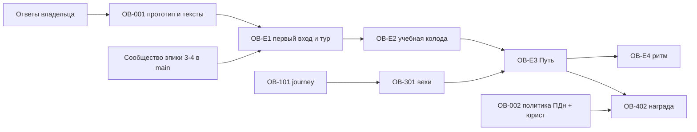

---
artifact:
  id: onboarding-rfc-2026-10
  type: rfc
  title: "RFC: onboarding — first entry, guided tour, sample deck, Path, rhythm and reward"
  status: historical
  updated_at: "2026-10-14"
  created_at: "2026-10-14"
  base_revision: "local/epic4 f4f5e636 (read-only); docs root 8f2b5522"
  owners: ["project-owner"]
  decision_scope: [first-entry, survey, tour-engine, sample-deck, milestones, rhythm, reward, measurement]
  evidence_accessed: "2026-10-14"
  reviews: ["self-review 2026-10-14; independent adversarial review pending before acceptance"]
---

# RFC: онбординг Mnema

Статус — **historical**. Владелец ответил на все вопросы 2026-10-14 ([questions](questions.md)). Принятые
решения перенесены в [proposal](proposal.md), [architecture](architecture.md), ADR и задачи; при
расхождении приоритет у них. Ниже — исходные рассуждения; рекомендации, которые владелец изменил,
отмечены в §8.

## 1. Коротко

- Онбординг — не один тур, а **шесть слоёв**: «Начало пути» (приветствие + опрос + выбор ветки),
  короткий spotlight-тур, «Моя первая колода», недельный ритм, «Путь Mnema» и (позже) награда.
- Самые сильные по доказательствам части — образец, короткий action-gated сценарий до первого занятия,
  контекстные подсказки и снисходительная привычка; самые слабые — длинные автотуры и срочные скидки
  ([research](research.md)).
- В коде уже есть вопрос о цели, интересы, копия O(1), уведомления/тосты, A/B, промокоды. Новое —
  journey state, движок тура без зависимостей, ledger вех, `deck.purpose`, ритм на чтении.
- Объём: четыре эпика, ≈ 40–63 ч агентного времени + прототип, тексты, шаблон и юрист.

## 2. Проблема и цели

Пришедший из Яндекс.Директа нетехнический пользователь после входа видит пустые «Мои колоды» или
пустое Сообщество. Цель — довести его до **первого завершённого занятия** и **второго дня занятий**,
не мешая опытным и не превращая продукт в игру. Не цель — максимизировать прохождение тура.

## 3. Идеи владельца: оценка

| Идея | Вердикт | Почему / что меняем |
|---|---|---|
| Онбординг пропускают знакомые с продуктом, проходят новички | Принять | Самосегментация на приветствии + вопрос об опыте; данных «эксперты пропускают» нет, но пропуск обязан быть равным |
| Вход до цен «прогревает» | Сохранить как есть | Противоположная практика Duolingo (ценность до регистрации, ≈ +20 % DAU) записана как альтернатива R6, не предлагается |
| Старт на странице Сообщества | Условно | Решение «стартовые колоды не готовим» → каталог может быть пуст; ветка видна только при ≥ 4 колодах по интересам (Q01/Q02) |
| «Звёздный» астральный экран | Принять для приветствия и поздравлений | Ночь из `--mn-ink` и звёзд `app-deck-constellation`; вуаль тура — чернильная без звёзд, чтобы не мешать чтению (Q12) |
| «Я уже знаком» + тост «пройти в профиле» | Принять | Проверенный паттерн; тост ведёт и в «Путь» |
| Затемнение с «окном» и tooltip рядом | Принять | Spotlight; карточка с «Шаг N из M», назад/дальше, не исчезает сама; a11y по WCAG 2.2 |
| Tooltip со слайдером | Принять ограниченно | Мини-слайдер внутри одного шага, не способ спрятать 14 шагов |
| Завершение удержанием как удаление | Отклонить (Q03) | Правило стайлгайда: удержание — только необратимое удаление; WCAG 2.1.1 требует пути без таймера; завершение обратимо → одно нажатие + «Вернуть» |
| Выбор: готовая колода или своя | Принять + третья ветка | «Посмотреть на примере» — главная ветка для новичков при пустом каталоге |
| Подсказка при долгом листании, «Ничего не нашли — создайте свою» | Принять | Just-in-time подсказка; пороги 45 с / 2 мин — стартовые эвристики |
| Тур по форку: название, описание, материалы, упражнения | Принять, ≤ 4 шагов | Chameleon: резкий спад после 4–5 шагов; остальное — в «Путь» |
| Показывать ли занятие | Да, короткое | Занятие — сама ценность; учебная колода даёт предсказуемое занятие ≤ 4 упражнений |
| AI и лимиты в конце, редирект на paywall | Карточка «ИИ в Mnema» без автоперехода (Q08) | Редирект после тура — давление; ссылка «Тарифы» и бесплатные лимиты честнее |
| «Моя первая колода» — песочница, нельзя шарить, можно править, остаётся | Принять | Копия шаблона CD-2 ([ADR-ONB-003](adr/adr-onb-003-sample-deck.md)); паттерн Notion «Getting Started» |
| AI-упражнение «объясни» принимает любой ответ | Отклонить | Обман учит неверному ожиданию; настоящий `ai-semantic` с мягкой строгостью первой встречи уже есть; кто платит — Q04 |
| Поздравление на весь экран + «чек-лист в профиле» | Принять | «Путь Mnema» с главами, стрелками и подсказками на месте |
| Achievements API | Заменить на ledger вех | Тот же реестр расширяется будущими «достижениями»; без очков и рейтингов ([ADR-ONB-002](adr/adr-onb-002-milestones.md)) |
| Стрик | Заменить недельным ритмом | Снисходительные механики выигрывают у Duolingo; прерванная серия вредит ([ADR-ONB-004](adr/adr-onb-004-rhythm.md)) |
| Не перегружать шапку | Принять | Ритм только на итогах занятия и в профиле; тосты вех через QuietZone |
| Тосты «вы сделали X» | Принять | Уведомление `PATH_MILESTONE` в транзакции действия, сводный тост, не во время ответа |
| Побочные квесты со стрелки | Принять | 2–4 шага тем же движком, по своей колоде |
| Повторное прохождение давним пользователем | Принять | Вехи — факты из истории (backfill), тур подставляет свои колоды |
| Опрос 5 вопросов с полосой | До 4 вопросов (Q06) | Только вопросы, меняющие следующий экран; без возраста/пола; ответы — ПДн |
| Промокод −10 % на 24 ч за 100 % | Отложить, 7 дней, без таймера (Q10) | Риск dark pattern и фарма; [ADR-ONB-005](adr/adr-onb-005-path-reward.md) |

## 4. Решения

| ID | Решение | Рекомендация | Отвергнуто |
|---|---|---|---|
| R1 | Когда предлагать | Один раз новому eligible аккаунту; старым — только «Путь» (Q13) | Всем при каждом входе; никому |
| R2 | Где хранить состояние | Learning, `onboarding_journey` | localStorage (нет многоустройства), Identity (нет доменных фактов) |
| R3 | Движок тура | Свой на нативных примитивах ([ADR-ONB-001](adr/adr-onb-001-tour-engine.md)) | Shepherd/intro.js (AGPL), driver.js (a11y), `@angular/cdk` (новая зависимость) |
| R4 | Длина | ≤ 4 шагов на ветку, только по выбору пользователя | 8–14-шаговый автотур |
| R5 | Образец | Копия шаблона по запросу, `deck.purpose` | Скрипт при регистрации, клиентская песочница, публичная колода |
| R6 | Ценность до регистрации | Не делать сейчас (решение владельца о входе) | Демо-колода гостю — вернуться при данных о конверсии регистрации |
| R7 | Чек-лист | Ledger фактов + backfill + главы 3–5 вех | Вычисление на чтении; клиентские отметки; движок достижений |
| R8 | Привычка | Недельный ритм без потерь | Ежедневная серия с заморозками |
| R9 | Награда | Отдельный gated эпик, системная выдача, 7 дней | Общий код; 24 ч с таймером |
| R10 | Измерение | A/B с постоянным holdout 10–20 %, активация = первое занятие ≤ 7 дней | Завершение тура как KPI |

## 5. Порядок поставки

OB-E1 и OB-E2 — одна двухсессионная очередь (без учебной колоды пустой каталог оставляет новичка без
лучшей ветки). Production-включение каждого эпика — флагом владельца после OB-002.

## 6. Риски

| Риск | Смягчение |
|---|---|
| Тур раздражает | Только по выбору, ≤ 4 шагов, пауза, равный пропуск, holdout покажет вред |
| Ломается при смене вёрстки | Стабильные anchors + тест реестра, fallback-текст |
| «Путь» и ритм как геймификация | Нет очков/рейтингов, ритм вне шапки, метрики — retention |
| Стоимость ИИ в учебной колоде | Лимит бесплатных проверок, отдельная категория usage (Q04) |
| Пересечение с learning-core в Study writers | Разные очереди, integrator владеет `StudySessionRepository`/`AttemptRepository` |
| ПДн опроса и вех | OB-002 до включения, сброс/просмотр в профиле, без передачи ИИ |
| Награда как dark pattern / фарм | Реальный срок, verified, одна на аккаунт, юрист |

## 7. Найдено попутно

- `app-hold-to-delete-button` на клавиатуре требует удерживать Enter/Space — по WCAG 2.1.1 нужен путь
  без таймера ([research §7](research.md#7-доступность-тура-и-удержания)). Отдельная задача стайлгайда,
  вне этого пакета.
- `@angular/cdk` в проекте нет; любое предложение «взять CDK» — это новая зависимость.

## 8. Что владелец решил иначе, чем рекомендовал RFC (2026-10-14)

| Тема | Рекомендация RFC | Решение владельца |
|---|---|---|
| Досрочное завершение тура | Одно нажатие + «Вернуть» | Удержание ~2 с, как удаление, со знаком «палец удерживает»; правило 4 стайлгайда расширяется |
| Пустое Сообщество | Ветка скрыта, стартовые колоды не готовим | Владелец готовит 10+ базовых колод (языки, программирование, инструменты) — OB-003 |
| Ритм | Только SCHEDULED | SCHEDULED и PRACTICE (не REPLAY) |
| Награда | Отложить до данных | Делать сразу в OB-E4: 7 дней с выдачи, один раз, флаг в prod после проверки условий |
| Находка про удержание на клавиатуре (WCAG 2.1.1) | Отдельная задача | Не брать в работу |
