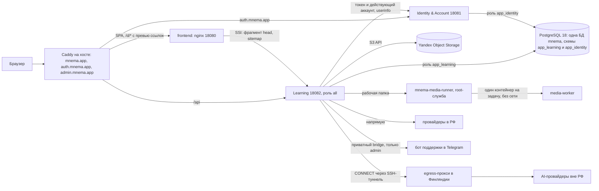

---
artifact:
  id: system-overview
  type: architecture-overview
  title: "Mnema current system overview"
  status: current
  updated_at: "2026-10-19"
  owners: ["project-owner"]
---

# Mnema: текущий обзор системы

Mnema напрямую заменяет v1 платформой вокруг versioned `LearningItem`. После Epic
#74 канонический authoring runtime уже находится в `identity-account`, `learning` и
Angular SPA. Epic #75 добавил objective/exercise authoring, bounded Study session
snapshots, deterministic attempts, baseline scheduler state и production exercise
authoring. Канонический Study runner проводит семь механик (`SELF_CHECK`,
`FREE_RESPONSE`, `CLOZE`, `CHOICE`, `MATCH`, `ORDER`, `CATEGORIZE`; #266, #268),
показывает progress и даёт replay/practice и явные session budgets. Persistent local
HTTPS runtime с MinIO и обработкой медиа также реализован. Epic #76 добавил native
media lifecycle, playback, offline manifest и безопасный GC в Learning; медиа
(в том числе аудио) — содержимое упражнения, а не отдельная механика.

Текущие модули поверх этой основы:

- AI-слой в `learning`: генерация материалов и упражнений помощником «Мнема» в Workshop,
  правки по выделению, семантическая проверка ответов, озвучка, распознавание речи (с отдельным
  согласием), поиск изображений, веб-исследование «Источники». Допущен в production 2026-10-15/16
  (генерация, проверка, озвучка, распознавание речи, поиск изображений и веб-поиск включены флагами;
  генерация изображений и видео недоступна); провайдеры, недоступные из РФ, вызываются через egress-прокси
  ([AI runbook](./operations/ai-runbook.md));
- планы и usage (тарифы, кредиты, fair-use, независимый выбор плана и цели обучения), billing,
  промокоды и кампании, A/B и промо-попап;
- колоды сообщества: доступ, публикация, копии и обновления, каталог, поиск, рекомендации, жалобы
  ([архитектура](./architecture/community-decks.md));
- онбординг: «Начало пути», «Путь Mnema», недельный ритм; включён в production с 2026-10-19, учебная колода и
  награда выключены ([пакет](./engineering/onboarding/README.md));
- публичные события продукта со ссылкой на поддержку в Telegram и кабинет владельца на `admin.mnema.app`.

## Топология production

Реальная раскладка: [VPS runtime](./operations/vps-runtime.md) и [Compose](../deploy/production/compose.yaml).

- Host Caddy — единственный публичный слушатель (80/443); контейнеры frontend, Identity, Learning и PostgreSQL
  работают на loopback, Caddy закрывает `/actuator`, `/internal`, `/metrics` и `/admin`. `admin.mnema.app` отдаёт ту же
  SPA и same-origin Learning `/api`; вход идёт клиентом `mnema-admin-web`
  ([архитектура кабинета](./architecture/admin-console.md)).
- Frontend nginx отдаёт SPA и подставляет Open Graph-превью `/d/*` и `/sitemap-decks.xml` из Learning без SSR
  ([link previews](./operations/link-previews.md)).
- Learning в production запускается ролью `all` (HTTP, воркеры шагов генерации, речи и проверки ответов);
  раздельные роли `api` и `worker` с ключами провайдеров только на воркере поддержаны отдельным overlay и в
  production не включены ([AI runbook](./operations/ai-runbook.md)). Egress-прокси — [AI egress proxy](./operations/ai-egress-proxy.md).
- Медиа обрабатывает root-служба `mnema-media-runner`: каждая задача — отдельный контейнер `media-worker` без сети.
- Бот поддержки — отдельный проект; Learning ходит к его приватному bridge только для кабинета владельца и
  при пустом `MNEMA_ADMIN_SUPPORT_ENDPOINT` честно показывает поддержку недоступной.
- Ежеминутная проверка здоровья и ежедневная локальная копия БД — systemd-таймеры хоста.

## Границы модулей и локальный runtime

- `services:identity-account` владеет account identity, credentials, browser
  sessions, OAuth/OIDC grants, federation, profile/moderation, account avatar,
  transfer и deletion lifecycle.
- `services:learning` владеет свежей `app_learning` migration history, platform
  contracts, immutable storage и личным content/authoring доменом.
- Angular SPA использует standalone components и lazy routes. Канонический #74 flow:
  Deck → Capture/«На потом» → EditingDraft → явная публикация → Browse.
- `compose.local-full-stack.yml` запускает persistent PostgreSQL, MinIO, Identity,
  Learning, сетевой изолированный media-worker и production Angular через localhost HTTPS;
  обычный stop/start сохраняет локальные данные
  ([runbook](./deploy/selfhost-local.md)). `docker-compose.yml` остаётся backend maintenance runtime.

У replacement нет `/v2`, aliases к v1, dual write/read или scheduler fallback.
Identity и Learning — отдельные deployables без Gradle dependency на legacy modules.

## Что реализовано в Learning

- private Deck create/list/read/metadata update с owner ACL, CAS и idempotency;
- deck-local LearningItem `(deckId, memberKey)`, immutable revisions и atomic
  publication;
- Mnema-owned native document v1, безопасный renderer contract, immutable
  block/page storage и counted-page edits;
- acknowledged server `EditingDraft` и durable `CaptureNote` с idempotent conversion;
- immutable `MemoryObjective`/Exercise revisions и bounded owner-scoped
  `SCHEDULED`/`REPLAY`/`PRACTICE` session snapshots;
- immutable exercise revisions с ключом ответа на ревизии (objective хранит только
  заголовок), семь детерминированных evaluators, durable evidence, versioned baseline
  reducer и explicit material restart без удаления истории; terminal attempt
  атомарно завершает bounded batch, а resume не возвращает решённые presentation;
- stateless `POST /api/exercise-previews` — тот же evaluator для интерактивного
  preview редактора упражнений; `GET /api/capabilities` — server-owned флаги и
  доступность настроенных AI-провайдеров (выключены по умолчанию);
- due-first scheduled selection, replay выбранной завершённой сессии текущего
  локального дня и practice по уже введённым objective с явным opt-in новых;
- единый scheduled scheduler с server-pinned quick 10/2 и standard 20/5 budgets;
- owner-scoped media assets, upload/finalize, worker processing, playback и
  offline manifest и объектный GC;
- cursor-bounded material progress без фиктивного mastery percentage, exact restart
  нового learning epoch и bounded retention raw/compact attempt payloads;
- UUID, canonical JSON, command receipts, RFC 9457 Problem Details, row-version CAS;
- bearer scope enforcement и fail-closed current-account validation через Identity;
- AI generation sessions, Мастерская с явным одобрением, правки, planner,
  image search, озвучка, диктовка, semantic assessment, usage ledger, планы и промокоды.
  Состояния и fixtures — в [generation](../contracts/generation/README.md),
  [speech](../contracts/speech/README.md), [Study](../contracts/study/README.md) и
  [usage](../contracts/usage/README.md); роли API/worker, flags и ограничения —
  в [AI runbook](./operations/ai-runbook.md).

Session закрепляет reducer/config identity и immutable presentations, а scheduled
attempt атомарно пишет одну transition только assessed objective. Replay/practice
оставляют canonical exposure, evidence и state неизменными; durable receipts и
tombstones сохраняют retry/conflict semantics после очистки payload.

## Frontend boundary

Replacement routes `/decks`, `/decks/:deckId` (хаб колоды: статистика, список материалов с выбором и массовым удалением,
форма за «Изменить»), deck-scoped `/decks/:deckId/materials/...` (материал, editor), `/decks/:deckId/capture` используют
выбранное paper/antiquity/indigo оформление. Главная `/` включает гравюру
Мнемозины и композицию принятого макета с реальными маршрутами и русским текстом.
Семантические CSS-токены находятся в `frontend/src/theme/tokens.css`, правила
оформления и проверки — в [бренд-контракте](./frontend/mnema-brand-and-ui-contract.md).
Прототип остаётся визуальным свидетельством, не Angular runtime. Отдельный lazy
редактор упражнения (#267) — одна колонка: выбор из семи механик, интерактивный
preview через серверный evaluator, пошаговая настройка ответа и список упражнений
материала; UUID/JSON пользователю не показываются. Native editor state не является
persisted format; frontend валидирует серверные envelopes и ETag/command contracts.

Lazy route `/decks/:deckId/study` запускается основной кнопкой «Учить» из своей
колоды. Реализованы PREPARING polling, свободный ответ без показа эталона до принятого
ответа, self-check reveal с четырьмя поведенческими оценками, multi-blank cloze с
серверно учитываемой first-grapheme подсказкой, native radio/checkbox choice,
соединение пар, упорядочивание и распределение по группам,
явные состояния completion/expiry/error и account-bound recovery точной pending
attempt после неопределённого сетевого результата. Terminal flow также включает replay из
выбранной сегодняшней сессии, practice с явной политикой новых материалов,
объяснимый progress и подтверждаемое «Учить заново».
Перед scheduled start пользователь выбирает короткую или стандартную границу, видит
её во время сессии и не получает ложной гарантии длительности по часам.

Legacy public-deck, template, old review, import, media и AI Angular routes и
клиенты удалены в #146. Профиль использует native Identity & Account API.

## Граница с v1

Gradle graph содержит только `identity-account` и `learning`; legacy migration
chains и сервисные исходники отсутствуют в текущем checkout. Исторический код
доступен через тег `v1-apache-final` и Git history.

## Проверка

- backend: compilation, unit/integration tests и per-service coverage floor;
- frontend: lint, component/protocol tests и production build;
- real PostgreSQL tests, Identity↔Learning black-box security/cancellation harness;
- real local HTTPS browser Identity/authoring harness;
- repository policy, security and release-contract checks, and VPS backup/restore tests;
- deterministic internal Markdown link/status validation.

Точные команды и платформы: [Repository guide](./engineering/repository-guide.md).
Acceptance #74: [integrated main evidence](./engineering/evidence/epic-74/verification/integrated-main-2026-09-19.md).

## Delivery boundary

Production: `mnema.app`, Identity: `auth.mnema.app`, RU VPS `135.106.175.30`
(`ssh mnema`). Публикация пяти immutable images и protected VPS rollout доступны
для разработки. Merge и live verification — разные результаты; точный путь и
admission описаны в [production delivery](./operations/production-delivery.md).

## Статус работ

Открытые работы и их статус ведутся в GitHub Issues и на Kanban-доске проекта; документы описывают
только действующее поведение. Пакет [Learning core](./engineering/learning-core/README.md)
предложен и не реализован.

Интеграционная проверка #75 и её пределы: [acceptance evidence](./engineering/evidence/epic-75/verification/integrated-main-2026-09-24.md);
Epic #76: [browser/Study evidence](./engineering/evidence/epic-76/integrated-browser/README.md).
Evidence до #266 использует имена удалённых механик; действующие — в
[`contracts/study`](../contracts/study/README.md).
